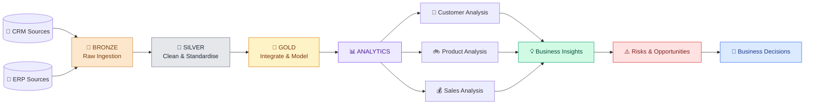
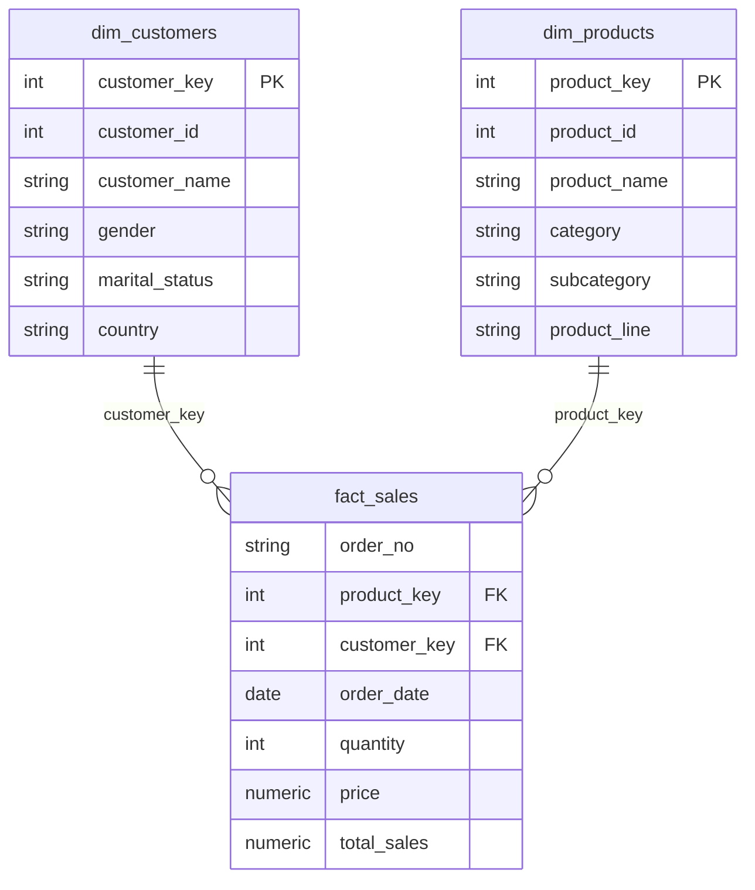

# 🚴 AdventureWorks Bicycle Retail
## End-to-End Data Warehouse & Advanced Analytics Project

### **From Raw Data to Business-Ready Insights**

*An end-to-end SQL project covering data ingestion, cleansing, dimensional modelling and multi-dimensional business analysis.*

---

## 🏁 Project Overview

This project uses the **AdventureWorks bicycle retail business scenario** to demonstrate how raw operational data can be converted into reliable, business-ready information and actionable insights.

Data from **CRM and ERP source files** is processed through three data-warehouse layers — Bronze, Silver and Gold — before being used in the Analytics Layer.

| Layer | Main Responsibility | Output |
|---|---|---|
| 🥉 **Bronze** | Load raw source data into predefined PostgreSQL tables | Raw CRM and ERP tables |
| 🥈 **Silver** | Clean, standardise and validate source data | Reliable, consistent tables |
| 🥇 **Gold** | Integrate related data and organise it for business use | Customer and product dimensions, sales fact view |
| 📊 **Analytics** | Explore business performance, identify patterns and communicate insights | Master tables, findings and recommendations |

> **Project flow:** Source Data → Raw Ingestion → Data Quality → Business Modelling → Analytics → Business Action

---

## 🏢 About the Business — AdventureWorks

**Adventure Works Cycles** is a fictional bicycle manufacturing and distribution business scenario provided by Microsoft as part of its sample database ecosystem. It represents a company selling bicycles, parts and accessories across multiple markets.

This project uses the AdventureWorks business scenario as a **bicycle retail analytics case study**. Its customer, product and sales data provides a practical setting for demonstrating data warehousing, SQL development and business analysis.

### 🚲 Business Areas Represented

| Business Area | Examples |
|---|---|
| Bicycles | Mountain, Road and Touring bikes |
| Maintenance | Tires, tubes and patch kits |
| Safety | Helmets and protective accessories |
| Hydration | Water bottles and bottle cages |
| Clothing | Jerseys, shorts, gloves and socks |
| Customers | Customer details, demographics and location |
| Sales | Orders, dates, quantities, prices and sales values |

The product range allows the analysis to examine both the core Bike business and the complementary products that can be purchased alongside a bicycle.

Business background: <a href="https://learn.microsoft.com/en-us/analysis-services/tutorial-tabular-1400/as-adventure-works-tutorial?view=sql-analysis-services-2025">Microsoft — Adventure Works tutorial</a> · <a href="https://learn.microsoft.com/en-us/sql/samples/adventureworks-install-configure?view=sql-server-ver16">AdventureWorks sample databases</a>

---

## 🗺️ Overall Project Architecture

**CRM + ERP → BRONZE → SILVER → GOLD → ANALYTICS**

### 🖼️ Project Structure & Visual References

- [**Initial Project Structure**](https://github.com/adityarajsinghgaharwar456/AdventureWorks-bicycle-retail-business/blob/main/project%20structure.png)
- [**Data Model View**](https://github.com/adityarajsinghgaharwar456/AdventureWorks-bicycle-retail-business/blob/main/AdventureWorks%20Data%20Model%20View.png)

---

## 🥉 1. Bronze Layer — Raw Data Ingestion

**Purpose: Bring source data into the warehouse without applying transformations.**

The Bronze layer is the starting point of the warehouse. CRM and ERP CSV files are loaded into predefined PostgreSQL tables with declared data types.

| Area | Summary |
|---|---|
| Input | CRM and ERP CSV files |
| Tables | Six raw source tables |
| Loading method | PostgreSQL `COPY` command |
| Automation | `load_tables()` stored procedure |
| Validation | `TABLE_INFO()` function for table row counts |
| Layer boundary | Raw ingestion only — no cleansing, transformation or modelling |

### Source Tables

| Source | Bronze Table |
|---|---|
| CRM | `crm_cust_info` |
| CRM | `crm_prd_info` |
| CRM | `crm_sales_details` |
| ERP | `erp_cust_details` |
| ERP | `erp_location` |
| ERP | `erp_prd_cat` |

**Explore this layer:** [🥉 Bronze Layer README](https://github.com/adityarajsinghgaharwar456/AdventureWorks-bicycle-retail-business/blob/main/script/Bronze_layer/bronze_layer_readme.md)

---

## 🥈 2. Silver Layer — Data Cleansing & Standardisation

**Purpose: Improve data quality, consistency and reliability while retaining the source tables as separate entities.**

The Silver layer takes the raw Bronze tables and applies controlled transformations to prepare the data for the next stage.

| Focus Area | Work Performed |
|---|---|
| Data cleansing | Trim unwanted spaces, handle missing values and remove duplicate customer IDs |
| Standardisation | Standardise coded values and text formats, including gender and country descriptions |
| Date handling | Convert source date values into usable date types and handle invalid date patterns |
| Key consistency | Clean and standardise source identifiers used to connect related data |
| Derived values | Create required product and date-related fields |
| Automation | `load_silver_layer_tables()` procedure refreshes the Silver tables |

### Silver Tables

The six CRM and ERP entities remain separate in this layer:

`crm_cust_info` · `crm_prd_info` · `crm_sales_details` · `erp_cust_details` · `erp_location` · `erp_prd_cat`

**Explore this layer:** [🥈 Silver Layer README](https://github.com/adityarajsinghgaharwar456/AdventureWorks-bicycle-retail-business/blob/main/script/silver_layer/silver_layer_readme.md)

**Visual reference:** [🖼️ Silver Layer Structure View](https://github.com/adityarajsinghgaharwar456/AdventureWorks-bicycle-retail-business/blob/main/script/silver_layer/Silver_layer_structure.png)

---

## 🥇 3. Gold Layer — Business-Ready Data Model

**Purpose: Integrate cleaned data and organise it into a model that is easier to query for reporting and analytics.**

The Gold layer brings related Silver-layer data together and exposes three business-oriented views.

| Gold Object | Object Type | Role |
|---|---|---|
| `gold_layer.dim_customers` | Dimension view | Combines customer, ERP customer-detail and location information |
| `gold_layer.dim_products` | Dimension view | Combines product attributes with category information |
| `gold_layer.fact_sales` | Fact view | Connects sales transactions to customer and product dimensions |

### ⭐ Model at a Glance

The fact view connects sales records to their customer and product dimensions, creating the foundation for customer-, product- and sales-oriented analysis.

**Explore this layer:** [🥇 Gold Layer README](https://github.com/adityarajsinghgaharwar456/AdventureWorks-bicycle-retail-business/blob/main/script/gold_layer/gold_layer_readme.md)

**Visual reference:** [🖼️ Data Model View](https://github.com/adityarajsinghgaharwar456/AdventureWorks-bicycle-retail-business/blob/main/AdventureWorks%20Data%20Model%20View.png)

---

## 📊 4. Analytics Layer — From Data to Business Insights

**Purpose: Examine the business from customer, product and sales perspectives and translate the findings into business implications and actions.**

The Analytics Layer uses business-ready Gold data to create custom master tables / views and perform multi-dimensional analysis with PostgreSQL.

### Three Analytical Channels

| Channel | Main Areas Covered | Analytics Master Object |
|---|---|---|
| 👥 **Customer-specific analysis** | Customer segmentation, spending, order frequency, order gap, geography, demographics, acquisition and churn | `customer_segmented_report` |
| 🚲 **Product-wise analysis** | Product grading, demand, sales, profit, category / sub-category performance, product-line assessment and product performance | `Product_segmented_report` |
| 💰 **Complete sales analysis** | Annual and quarterly performance, category timeline assessment and market basket / product affinity analysis | `sales_view_table` |

### Analysis Methods

- Database and measures exploration
- Magnitude and ranking
- Change-over-time analysis
- Cumulative analysis
- Performance analysis
- Part-to-whole analysis
- Data segmentation
- Customer acquisition and churn analysis
- Product affinity / Market Basket Analysis
- Cross-category and cross-selling analysis
- Business insight reporting

### Business Questions Addressed

**Customer:** Who contributes most to revenue? How do spending, demographics, geography and repeat-purchase behaviour differ across customer groups?

**Product:** Which products and categories drive demand, revenue and profit? Which segments underperform? Where is product concentration visible?

**Sales:** How does performance change over time? Which quarters are strongest? Which products are bought together? Where can cross-selling and bundles improve the basket?

### Reporting Protocol

The insight reports follow a consistent business-analysis structure:

1. **Key Finding / Insight** — what the data reveals.
2. **Reason** — why the observed condition may have occurred, where the evidence supports an explanation.
3. **Business Impact / Consequence** — why the finding matters to the business.
4. **Recommendation** — what action may address a risk or capture an opportunity.

The reports also highlight key concerns requiring management attention, followed by key takeaways and a conclusion.

**Explore the full report:** [📈 Advanced Analytics — Insight Reports Summary](https://github.com/adityarajsinghgaharwar456/AdventureWorks-bicycle-retail-business/blob/main/script/analytics_layer/insight_reports_summary_master.md)

---

## 🧰 Technology & SQL Skills Demonstrated

| Area | Tools / Techniques |
|---|---|
| Database | PostgreSQL |
| SQL Environment | pgAdmin |
| Data ingestion | `COPY`, CSV loading, stored procedures |
| Database design | Schemas, tables, data types, primary and foreign keys |
| Data preparation | Cleansing, standardisation, date handling and deduplication |
| Warehouse modelling | Views, dimensions, fact view and joins |
| SQL programming | CTEs, subqueries, CASE expressions and aggregate functions |
| Advanced SQL | Window functions, ranking, running totals, percentage contribution and conditional aggregation |
| Analytical methods | Segmentation, time-series analysis, acquisition / churn, product affinity and cross-selling |

---

## 💡 Business Value Demonstrated

The project demonstrates how a structured data workflow can support business understanding and decision-making:

- **Customer understanding:** identify valuable customer groups and patterns in purchasing behaviour.
- **Product performance:** distinguish volume drivers from revenue and profit drivers.
- **Sales monitoring:** observe growth, decline and quarterly performance patterns.
- **Cross-selling:** identify complementary products and bundle opportunities.
- **Risk identification:** highlight revenue concentration, weak product segments and customer-retention concerns.
- **Action-oriented reporting:** connect findings with business impacts and recommendations.

---

## 📚 Project Documentation — Quick Navigation

| Component | Documentation / Visual |
|---|---|
| 🗺️ Initial project structure | [View Project Structure](https://github.com/adityarajsinghgaharwar456/AdventureWorks-bicycle-retail-business/blob/main/project%20structure.png) |
| 🥉 Bronze layer | [Bronze Layer README](https://github.com/adityarajsinghgaharwar456/AdventureWorks-bicycle-retail-business/blob/main/script/Bronze_layer/bronze_layer_readme.md) |
| 🥈 Silver layer | [Silver Layer README](https://github.com/adityarajsinghgaharwar456/AdventureWorks-bicycle-retail-business/blob/main/script/silver_layer/silver_layer_readme.md) |
| 🖼️ Silver structure | [Silver Layer Structure View](https://github.com/adityarajsinghgaharwar456/AdventureWorks-bicycle-retail-business/blob/main/script/silver_layer/Silver_layer_structure.png) |
| 🥇 Gold layer | [Gold Layer README](https://github.com/adityarajsinghgaharwar456/AdventureWorks-bicycle-retail-business/blob/main/script/gold_layer/gold_layer_readme.md) |
| 🧩 Gold data model | [Data Model View](https://github.com/adityarajsinghgaharwar456/AdventureWorks-bicycle-retail-business/blob/main/AdventureWorks%20Data%20Model%20View.png) |
| 📈 Analytics layer | [Advanced Analytics Insight Reports](https://github.com/adityarajsinghgaharwar456/AdventureWorks-bicycle-retail-business/blob/main/script/analytics_layer/insight_reports_summary_master.md) |

---

## 🏁 Conclusion

This project demonstrates a complete SQL-based data warehousing and analytics workflow for the AdventureWorks bicycle retail business scenario.

Starting from raw CRM and ERP files, the data is progressively ingested, cleaned, integrated and organised into a business-ready model. The Analytics Layer then examines the business through customer, product and sales perspectives, turning prepared data into findings about performance, customer behaviour, product relationships, business risks and potential growth opportunities.

## **SOURCE → BRONZE → SILVER → GOLD → ANALYTICS → BUSINESS ACTION**

*Built with PostgreSQL · Advanced SQL · Data Warehousing · Business Analytics*

