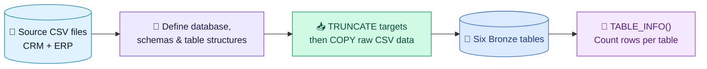

<div align="center">

# 🥉 Bronze Layer — Raw Data Ingestion

### **Source CSVs → PostgreSQL Bronze Tables**

*The landing zone of the AdventureWorks Bicycle Retail data warehouse.*


**Goal:** Load source data into predefined tables while preserving the raw values for downstream processing.

</div>

---

## 🧭 Pipeline at a Glance



> **Bronze principle:** land the data first; cleanse, standardise, join, and model it in later layers.

## ⚙️ What This Layer Does

<details>
<summary><strong>1. 🏗️ Set up the database and schemas</strong></summary>

- Database: `adventureworks_bicyle_retail` *(spelling follows the SQL script)*
- Schemas: `bronze_layer`, `silver_layer`, and `gold_layer`
- Define six Bronze tables with explicit PostgreSQL data types aligned to the expected source columns.

</details>

<details>
<summary><strong>2. 📥 Load six source CSVs</strong></summary>

| Source group | Bronze table | Source file |
|---|---|---|
| CRM | `crm_cust_info` | `cust_info.csv` |
| CRM | `crm_prd_info` | `prd_info.csv` |
| CRM | `crm_sales_details` | `sales_details.csv` |
| ERP | `erp_location` | `LOC_A101.csv` |
| ERP | `erp_cust_details` | `CUST_AZ12.csv` |
| ERP | `erp_prd_cat` | `PX_CAT_G1V2.csv` |

The `load_tables()` PL/pgSQL procedure truncates each target table, then loads its CSV with `COPY ... FROM ... DELIMITER ',' CSV HEADER`.

</details>

<details>
<summary><strong>3. 🔍 Check ingestion counts</strong></summary>

The SQL function `TABLE_INFO()` returns each of the six table names and its `COUNT(*)`, making it easy to confirm whether rows were loaded.

```sql
SELECT * FROM table_info();
```

</details>

## 🧱 Bronze Table Map

| Table | Purpose inferred from table name / columns | Key columns |
|---|---|---|
| `crm_cust_info` | CRM customer attributes | `cst_id`, `cst_key`, names, status, create date |
| `crm_prd_info` | CRM product attributes | `prd_id`, `prd_key`, `prd_nm`, cost, dates |
| `crm_sales_details` | Sales transaction details | order number, product key, customer ID, dates, sales, quantity, price |
| `erp_location` | ERP location/country attributes | `CID`, `CNTRY` |
| `erp_cust_details` | ERP customer details | `CID`, `BDATE`, `GEN` |
| `erp_prd_cat` | ERP product category metadata | `ID`, `CAT`, `SUBCAT`, `MAINTENANCE` |

<sub>Descriptions above are based on table names and declared columns in the SQL script.</sub>

## 🛠️ SQL Toolkit

| Feature | How it is used |
|---|---|
| DDL | `CREATE DATABASE`, `CREATE SCHEMA`, `CREATE TABLE` |
| Reload strategy | `TRUNCATE TABLE` before each import |
| CSV ingestion | `COPY ... FROM ... CSV HEADER` |
| Automation | `load_tables()` stored procedure |
| Row-count validation | `TABLE_INFO()` SQL function and `COUNT(*)` |

## 🚦 Layer Boundaries

| 🥉 Bronze — this layer | 🥈 Silver — next layer | 🥇 Gold — downstream layer |
|---|---|---|
| Ingest source data | Clean and standardise | Model for analytics |
| Define table structure | Validate and resolve data issues | Build dimensions and facts |
| Preserve raw values | Apply controlled transformations | Serve reporting and BI |

## ⚠️ Implementation Notes

- **Full refresh:** `TRUNCATE` followed by `COPY` replaces existing table contents on each run; this is not an incremental load.
- **No transformations here:** the procedure does not cleanse, derive, standardise, join, or model imported data.

---

<div align="center">

### 🌱 Raw In. Reliable Foundation. Analytics Next.

**Bronze → Silver → Gold**

*Built with PostgreSQL · PL/pgSQL · CSV ingestion*

</div>
