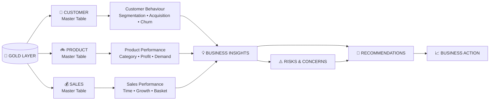
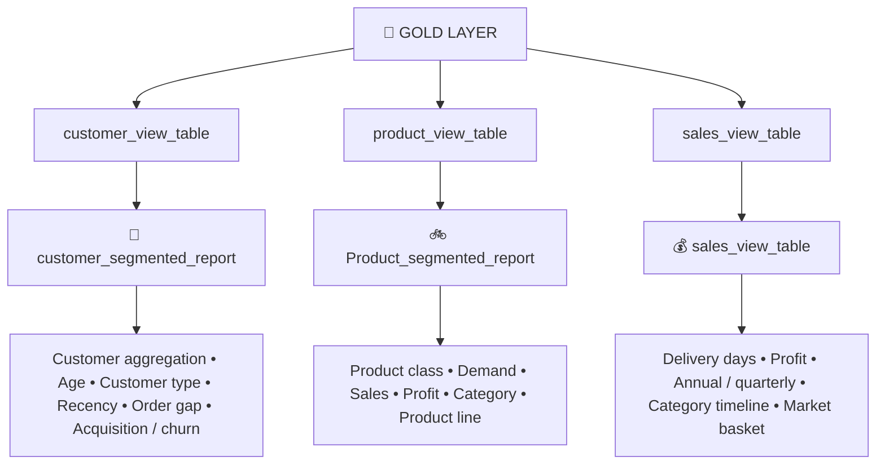
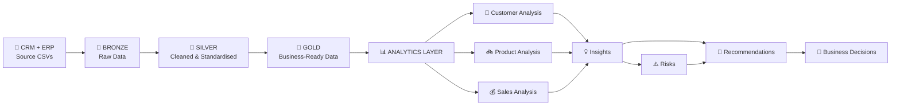

# 📊 AdventureWorks Bicycle Retail — Analytics Insight Reports

<div align="center">

**From Data → Analysis → Insight → Business Action**


</div>

> **advance anlytics make detailed postmortem of company data and extract insights from data. it make in-depth examination of data via multi-dimensional analysis methods to gather insights from data and built a reports based on all analysis. it figures out all business questions, point out trends, patterns and vigil management about any risk/concern identified during anlysis.**

---

## 🧭 Analytics at a Glance



## 🎯 What This Analytics Layer Does

The analytics layer is designed to make a **detailed postmortem of company data and extract insights from data**.

| Analytical Channel | Main Purpose | Master Table |
|---|---|---|
| 👥 **Customer Specific Analysis** | Customer behaviour, spending, demographics, acquisition and churn | `customer_segmented_report` |
| 🚲 **Product-wise Analysis** | Product demand, categories, profitability, product grading and cross-category performance | `Product_segmented_report` |
| 💰 **Complete Sales Analysis** | Timeline performance, growth, quarterly trends and product affinity | `sales_view_table` |

### 🔎 Analytical Approach

| Analysis | What it helps identify |
|---|---|
| Database and measures Exploration | What data and measures are available |
| Magnitude and ranking | Largest / smallest contributors |
| Change-Over-Time Analysis | Growth, decline and turning points |
| Cumulative analysis | Contribution and concentration |
| Performance Analysis | Business and product performance |
| Part-To-Whole anlysis | Weightage / contribution |
| Data segmentation | Meaningful customer / product groups |
| Reporting | Business findings and action points |
| Advanced analytics | Customer churn, acquisition, cohort and product affinity |

---

## 🧱 Analytics Master Tables

The analytics layer imports cleaned and standardised data from the Gold Layer and creates custom master tables containing **derived columns, calculated measures and business-rule based classifications** for visualization and insight reporting.



---

# 📌 KPI Reference

## 👥 Customer KPIs

| KPI | Business Meaning |
|---|---|
| Total Orders | Customer purchase activity |
| Total Quantity | Product quantity purchased |
| Total Sales | Customer contribution to revenue |
| Average Order Value | Customer-wise total sales / total orders |
| Customer Lifespan | Time between first and last order |
| Recency | Time difference between last order date and current date |
| Average Order Gap | Average time between customer orders |
| Customer Type | Business-rule based customer classification |
| Acquisition Rate | New customers added over time |
| Churning Rate | Customers not returning in the following year |

## 🚲 Product KPIs

| KPI | Business Meaning |
|---|---|
| Total Units Sold | Product demand |
| Total Orders | Product transaction activity |
| Total Sales | Revenue contribution |
| Profit | Direct financial contribution |
| Profit % | Profitability efficiency |
| Unit Price | Average selling price |
| Product Class | Business-rule based product performance |
| Production Period | Product selling period |
| Revenue Share | Contribution to category / business revenue |

## 💰 Sales KPIs

| KPI | Business Meaning |
|---|---|
| Total Units Sold | Total customer demand generated |
| Quantity % | Contribution to overall volume |
| Total Sales | Revenue generated during the period |
| Sales % | Contribution to total business revenue |
| Total Profit | Financial value created after costs |
| Profit % | Contribution to total business profit |
| Revenue Productivity | Revenue generated from demand volume |
| Profit Productivity | Profit generated from revenue growth |
| Mutual Orders | Number of orders in which both products were purchased together |
| Cross-Sell Opportunity | Potential to recommend associated products |
| Bundle Potential | Opportunity to create combined offerings |

---

# 👥 01 — CUSTOMER-SPECIFIC ANALYSIS

> **This section prioritises more on customers influence on sale by analysisng their pattern like spending range, geographic distribution etc.**

## Master Table — `customer_segmented_report`

The master table is used for **visualization, insight reporting and interactive dashbord**.

It includes customer-wise aggregation metrics, age and age-group, customer type, total orders, total quantity, total sales, average order value, first and last order dates, customer lifespan, recency, average order gap, country, acquisition and churn analysis.

### Customer Classification

| Business Rule | Customer Type |
|---|---|
| `total_sales > 2500` and `order_frequency > 10` | ⭐ VIP |
| `total_sales > 5000` | 💎 Big Spenders |
| `total_sales > 100` and `order_frequency > 1` | 🔁 Regular |
| `total_sales <= 100` and `order_frequency > 1` | 📦 Low-value customers |
| `order_frequency = 1` | 🆕 New Customers |

## 💡 Key Customer Findings

### Regular Customers Dominate the Customer Base

> **Regular Customers → with 44% + of total customers is most frequent type in customer cat.**

VIP customers are very least with only **0.29% of total customers**.

### Big Spenders Create Disproportionate Revenue

> **Big spenders though only comprises 9% of total customers but contribute 36% of total sale**

**Business Impact:** A relatively small customer segment contributes a disproportionately large share of revenue.

**Recommendation:** Protect and develop high-value customers while improving conversion of regular customers into higher-value repeat customers.

### Customer Concentration Is Visible Geographically

> **More than half (55%) of total customers comes from just 2 locations – USA & Australia**

Germany and France have reported least sale → less than 10% as compare to other countries like USA with 33.9% of total customers.

> **Canada has lowest avg_cust_spending despite higher no. of customers visiting store fom this location indicates that customer here more prefers buying cheaper goods**

### Majority of Customers Spend in Low-to-Moderate Range

> **75% of customers spending range between $ 2 – $ 2500 i.e. majority of people are spending on low to moderate range project**

Only **25% of customers are spending on high grade products i.e. $2500+**.

### Customer Order Frequency

| Finding | Observation |
|---|---:|
| New customers | **13.5%** |
| Customers placing >10 orders | **<1%** |
| Customers returning after 1st order | **99%** |

> **Max orders does not mean higher customer spending.**

Example:

- Max order → **68 orders**, sale → **$1,616**
- Max sale → **9 orders**, sale → **$13,489**

### Order Gap Shows a Retention Concern

> **Only 20.25% of customers return to store within year**

This indicates that less customers are taking interest on our products and come back to store. But there may be also chances that goods are performed well enough that customer don’t require to comeback.

### Customer Demographic Analysis

| Dimension | Key Finding |
|---|---|
| Age | **40–55 age-group represents more than 50% of sales** |
| 70+ | Least contributor in total sales |
| Gender | Both gender are equally contributing in total orders; Male group shows slight more interest |
| Marital Status | Married customers contribute **51.7% of total sale** |
| Orders | Singles placed **8.5K** orders vs married **10.01K** |

### 📈 Acquisition & Churn

> **Year 2013 is the only year where highest number of new customers added.**

> **Customer addition is taking place at positive rate if we compare from previous years**

For churn:

> **Only customers of 2012 have lowest churning rate → 8.8 % only.**

> **Rest years, 90%+ Churn rate has been reported (Not a good thing)**

**Note:** The SQL churn calculation is an annual non-return measure: customers purchasing in year `Y` but not returning in `Y+1`.

---

# 🚲 02 — PRODUCT-WISE ANALYSIS

> **This section prioritises more on Products and its categories performance. it aims to observe trends, pattern and its impact on sale.**

## Master Table — `Product_segmented_report`

The master table contains derived and calculated columns including average/unit price, production period, total orders, total units sold, total sales, total cost, profit, product class, product category, sub-category and product line.

### 🏷️ Product Classification

| Product Class | Business Rule | Business Meaning |
|---|---|---|
| ⭐ Star Product | High sales + high demand | Strong revenue and strong demand |
| 💎 Premium Product | High sales | Generates high revenue despite fewer orders |
| 📦 Volume Driver | High quantity | Frequently purchased but lower revenue contribution |
| 📈 Avg. Performer | Moderate sales | Stable performer with average sales and demand |
| ⚠️ Underperformer | Low sales | Weak sales and weak demand |

> **Average performer and Star product have major share in total product list**

> **Great!! thing is underperming products has very low weightage in sale**

### Statistical Observation

> **Huge gap between mean and median indicates high positive skewness in products ordered which mean cheaper products dominates total sales.**

> **75% of total products have fewer orders i.e. below 500 orders, despite max orders of 4000+ of certail products**

### Demand

| Product | Units Sold | Observation |
|---|---:|---|
| Water Bottle - 30 oz. | **4,249** | Highest selling product |
| Patch Kit/8 Patches | **3,191** | High-volume accessory |
| Mountain Tire Tube | **3,096** | High-volume accessory |
| Mountain-100 Silver-48 | **36** | Lowest selling product |

> **Though Mountain-100 Silver-48 has lowest sale but because it is high value product → $3400 per unit and total sale → $ 122,400 as compare to Water Bottle - 30 oz. → $ 5 per unit only and total sale → $ 21,245. So, both are different class of product so cant be compared.**

- Only **3 products** sold 3,000+ units.
- **1/3rd** of the products per unit sale is below 100 units.
- **79%** of products demand lies below 500 Units.

---

## 🏆 Product Category Performance

### 🚲 Bikes — Core Business Driver

> **Bikes contribute 96.4% of total revenue. → Core business driver**

> **company's financial performance is overwhelmingly dependent on Bike sales.**

> **Any improvement or decline in Bike performance will directly impact total business revenue.**

⚠️ Any downfall in sale of premium products or sale of bike categories would amount to huge fall revenue because of its heavy margin in total sale.

### 🧩 Accessories — Volume Engine

> **despite having less contribution in total revenue(2.4%) it become best performers in terms of total units sold, accounting for 59.8% of all units sold**

> **For every 100 products sold, approximately 60 were Accessories.**

- In 2013, Accessories represented **58.9% of total units sold**.
- Tires and Tubes + Helmets contribute **67.12%** of Accessories sales.
- Tires and Tubes account for **48.01%** of units sold.
- Bottles and Cages account for **22.14%** of units sold.
- Helmets account for **17.84%** of units sold.
- Cleaners contribute only **1.04%** of sales.

> **Accessories Experienced Hyper-Growth and Became the Company's Largest Volume Category → 324x growth ↑**

**Business Impact:** Accessories appear to be low-cost, repeat-purchase products and provide an excellent cross-selling opportunity.

---

## 🚴 Road vs ⛰️ Mountain vs 🧳 Touring

| Product Line | Revenue Share | Profit Share | Strategic Position |
|---|---:|---:|---|
| 🚴 Road | **50.9%** | **47.1%** | Financial booster |
| ⛰️ Mountain | **35.7%** | **39.9%** | Profit efficiency |
| 🧳 Touring | **13.5%** | **13.0%** | Lowest contributor |

### Road Bikes Are the Company's True Financial booster

> **Although Mountain Bikes lead in unit sales, Road Bikes dominate both revenue and profitability.**

- Road Bikes generated **$14.6M revenue**
- Road Bikes generated **$5.37M profit**
- Nearly **1 out of every 2 profit dollars** originates from Road products.

**Business Impact:** Road Bikes are not merely another product line; they are the primary financial pillar supporting the bike business.

**Recommendation:**

- Consistent maintenance of road bike inventory to catch uneven demand fluctuation
- Stable pricing to avoid sudden customer churning
- Restructuring touring bike sale strategy to boost its sale

### Mountain Bikes Win Customer Demand but Lose Revenue Leadership

- Mountain Bikes account for **45.6%** of all bike units sold.
- Mountain Bikes generate **35.7%** of bike revenue.
- Mountain Bikes sold **16.9K units** vs Road Bike **15.6K units**.
- Road Bikes generated **43% more revenue**.

> **Mountain Bikes appear to be the most financially efficient category within the core bike business.**

---

# 💰 Profitability Analysis

## High-Margin Products Are Not Always High-Profit Products

| Product | Profit Margin | Total Profit |
|---|---:|---:|
| Road Tire Tube | **75%** | **$7,128** |
| Mountain-200 Black-46 | **43.48%** | **$597K** |

> **Despite having almost half the margin, Mountain-200 generates 84× more profit.**

**Reason:** Profit is driven by the combination of Margin, Revenue scale and Demand volume.

**Business Impact:** Focusing solely on profit percentages can lead to incorrect business decisions.

### 🏔️ Mountain-200 Profit Concentration

| Product | Profit |
|---|---:|
| Mountain-200 Black-46 | **$597K** |
| Mountain-200 Black-42 | **$594K** |
| Mountain-200 Silver-38 | **$585K** |
| Mountain-200 Silver-46 | **$567K** |
| Mountain-200 Black-38 | **$566K** |
| Mountain-200 Silver-42 | **$548K** |

**Combined profit: $3.46 Million**

> **The company earns a significant portion of its profitability from a single product family.**

This creates both:

- Strong competitive advantage
- Product concentration risk and overdependency

### Accessories Deliver Exceptional Profit Margins Despite Low Revenue

Many accessory products generate **60%–75% profit margins**, substantially exceeding most bike products.

> **Although accessories contribute relatively little revenue, they generate highly efficient profits.**

**Recommendation:** Increase accessory attachment rates with bike purchases.

### Clothing

> **Clothing Achieved Significant Growth but Failed to Scale Commercially**

- Clothing showed exceptional volume growth → **395× increase**
- Financial impact remained limited.

**Business Impact:** Clothing successfully attracted customers but failed to generate comparable revenue growth.

---

# 💰 03 — COMPLETE SALES ANALYSIS

> **In this section, we will explore customer orders patterns and how different categories of products and customers segments are performing on diverse timeline and also examine growth trends.**

## Sales Snapshot

| Metric | Value |
|---|---:|
| Total Orders | **60,398** |
| Total Distinct Orders | **27,659** |
| Distinct Orders with >1 Product | **17,991** |
| Sales Period | **Dec. 2010 → Jan. 2014** |
| Complete-year trend scope | **2011–2013** |

> **2010 and 2014 are excluded from annual / quarter trend evaluation.**

---

## 📈 2013 Was the Company's Defining Growth Year

| Year | Unit Share | Sales Share | Profit Share |
|---|---:|---:|---:|
| 2011 | 3.8% | 24.2% | 24.3% |
| 2012 | 5.8% | 20.0% | 17.7% |
| 🚀 2013 | **90.4%** | **55.9%** | **58.1%** |

### Key observations

- **90.4%** of all units sold occurred in 2013.
- **$16.3M** sales generated in 2013.
- **$6.76M** profit generated in 2013.
- More than **1 out of every 2 revenue dollars** was generated during 2013 alone.
- 2013 added the largest number of new customers → **67.75%**.

> **2013 represents the company's real growth phase and serves as the benchmark year for evaluating future performance.**

---

## ⚠️ 2012 Sold More Products but Generated Less Business Value Than 2011

Compared with 2011:

- Units Sold ↑ **53%**
- Sales ↓ **17%**
- Profit ↓ **27%**

> **Growth in volume alone does not guarantee business growth.**

**Reason:** Accessories (complementary goods) which is also a low value products as compare to premium bike products shows largest sales of all years.

**Business Impact:** The company experienced volume expansion but lost revenue productivity and profit productivity.

---

## 🚀 2013 Restored Both Scale and Profitability

| KPI | Change |
|---|---:|
| Units Sold | **15.5× higher** |
| Sales | **2.8× higher** |
| Profit | **3.3× higher** |

> **The company did not simply generate more revenue; it converted a larger portion of revenue into profit.**

**Business Impact:** This indicates healthier growth quality and stronger profit generation.

---

## 🗓️ Quarterly Performance

> **Each Year Reached Peak Performance in Q4**

**Business Impact:** Customer spending appears to intensify toward year-end.

**Recommendation:** Allocate maximum support to Q4 through:

- Inventory readiness
- Promotions
- Premium bike campaigns
- Accessory bundles

### 2013 Quarter-to-Quarter Momentum

From Q1 → Q4 2013:

- Sales increased **99%**
- Profit increased **99%**
- Units sold increased **74%**

> **Growth was not concentrated in a single successful quarter, rather strengthened throughout the year.**

---

# 🛒 Market Basket / Product Affinity Analysis

> **It aims observe products that are purchased together frequently within same orders, which means, it shares mutual relationship with each other**

## Top Product Relationships

| Product Combination | Mutual Orders |
|---|---:|
| Mountain Bottle Cage + Water Bottle | **1,692** |
| Road Bottle Cage + Water Bottle | **1,521** |
| HL Mountain Tire + Mountain Tire Tube | **957** |
| Touring Tire + Touring Tire Tube | **808** |
| Mountain Tire Tube + Patch Kit | **785** |
| ML Mountain Tire + Mountain Tire Tube | **776** |
| ML Road Tire + Road Tire Tube | **606** |

### 💧 Water Bottles Are the Universal Attachment Product

> **The Water Bottle acts as a "gateway accessory" across multiple customer segments.**

| Combination | Mutual Orders |
|---|---:|
| Mountain Bottle Cage + Water Bottle | **1,692** |
| Road Bottle Cage + Water Bottle | **1,521** |
| AWC Logo Cap + Water Bottle | **626** |
| Helmet Red + Water Bottle | **382** |
| Helmet Black + Water Bottle | **365** |
| Helmet Blue + Water Bottle | **363** |

### 🔧 Tire Maintenance Products Form the Strongest Product Ecosystem

Customers naturally purchase:

**Tire → Tube → Repair Kit**

Examples:

- HL Mountain Tire + Mountain Tire Tube → **957**
- Touring Tire + Touring Tire Tube → **808**
- Mountain Tire Tube + Patch Kit → **785**
- ML Mountain Tire + Mountain Tire Tube → **776**

**Business Impact:** Customers naturally purchase Tire, Tube, Repair Kit as a complete maintenance solution rather than standalone products.

### 🪖 Helmets — High-Demand Safety Products

> **Customers perceive helmets as an essential purchase rather than an optional accessory.**

Helmets show **strong demand and high margins (~63%)**.

**Recommendation:** Increase sale by giving cashback offer for buying combo pack of helmet, tire tube and water bottle.

### 🚲 Mountain-200 Customers — Strong Cross-Sell Opportunity

| Product Pair | Orders |
|---|---:|
| Mountain-200 Black-42 + Mountain Bottle Cage | **129** |
| Mountain-200 Black-38 + Mountain Bottle Cage | **127** |
| Mountain-200 Silver-38 + Mountain Bottle Cage | **127** |
| Mountain-200 Black-46 + Mountain Bottle Cage | **123** |
| Mountain-200 Silver-46 + Mountain Bottle Cage | **113** |
| Mountain-200 Silver-42 + Mountain Bottle Cage | **106** |

> **Mountain Bike customers exhibit significantly stronger ecosystem buying behavior than many other bike segments.**

---

# 🛍️ Cross-Selling Breakthrough

| Measure | 2012 | 2013 |
|---|---:|---:|
| Accessories per Bike | **0.03** | **3.55** |
| Accessory Sales per Bike | **$0.66** | **$68.78** |

> **Customers bought 118× more accessories per bike.**

For every bike sold in 2013:

- **3.5 accessory items**
- **1 clothing item**

### Every Bike Customer Represents an Additional $102 Revenue Opportunity

| Category | Sales per Bike |
|---|---:|
| Accessories | **$68.78** |
| Clothing | **$33.36** |
| **Total** | **$102.14** |

> **This is one of the strongest indicators of successful cross-selling.**

---

# 📅 Seasonal Cross-Selling Behaviour

### High Cross-Sell Months

| Month | Accessory Spend / Bike |
|---|---:|
| March | **$56.99** |
| January | **$55.46** |
| February | **$53.85** |
| April | **$52.72** |
| May | **$51.20** |

**Average: ~$54 per bike**

### Low Cross-Sell Months

| Month | Accessory Spend / Bike |
|---|---:|
| December | **$39.32** |
| June | **$40.24** |
| November | **$41.82** |

**Average: ~$40 per bike**

> **Customers spend approximately 35-40% more on accessories during peak months compared to low-spending periods.**

**Recommendation:** Concentrate bundle offers, Helmet promotions and Cycling gear campaigns during months showing historically higher cross-sell behaviour.

---

# ⚠️ KEY BUSINESS CONCERNS / RISKS

| Priority | Concern | Evidence | Business Impact |
|---|---|---|---|
| 🔴 HIGH | Bike revenue dependency | Bikes contribute **96.4%** of total revenue | Any decline directly impacts total business revenue |
| 🔴 HIGH | Premium product concentration | Mountain-200 family generates **$3.46M** combined profit | Profit concentration / overdependency |
| 🔴 HIGH | High annual churn | 90%+ reported in most years except 2012 | Potential customer retention problem |
| 🟠 MEDIUM | Geographic concentration | USA + Australia = **55%** of customers | Regional dependency |
| 🟠 MEDIUM | Mid-range weakness | Mid-range products reported lowest sale | Missed portfolio opportunity |
| 🟠 MEDIUM | Touring cross-sell weakness | Touring contributes <15% across major KPIs | Secondary-category growth risk |
| 🟠 MEDIUM | Complementary-product dependency | Accessories / clothing growth varies strongly by year | Revenue diversification needs monitoring |

---

# 🎯 Recommended Business Actions

### 01 — Protect the Core Revenue Engine

Maintain strong inventory, pricing and promotion discipline around **Road Bikes, Mountain Bikes and premium bike families**.

### 02 — Increase Accessory Attachment

Use bike purchases as the entry point for:

- Water Bottle + Bottle Cage
- Tire + Tube
- Tube + Patch Kit
- Helmet + Water Bottle
- Bike + Maintenance bundles

### 03 — Reduce Product Concentration Risk

> **continuously diversify profit generation through: Accessories, Clothing, Mid-tier bike offerings**

### 04 — Improve Mid-Range Product Performance

> **Mid-range products had reported lowest sale. It require actions to be taken to increase sale of mid-range products**

### 05 — Strengthen Customer Retention

Investigate why only **20.25%** of customers return within a year and distinguish between true churn, long product replacement cycles and customers whose products do not require frequent repurchase.

### 06 — Use Q4 as a Strategic Planning Window

Prepare inventory readiness, promotions, premium bike campaigns and accessory bundles ahead of the strongest commercial period.

### 07 — Build Touring-Bike Cross-Sell Strategy

> **Investigate why customer is not taking interst on buying accessories and clothing while purchasing and touring bikes**

Then adjust customer convenience and provide discounts on complementary products.

---

# 🔥 Executive Key Takeaways

| 🏆 | Key Takeaway |
|---|---|
| 🚲 | **Bikes are the core business driver**, contributing 96.4% of total revenue. |
| 🚴 | **Road Bikes are the company's true financial booster**, leading revenue and profitability. |
| ⛰️ | **Mountain Bikes win customer demand and profit efficiency**, but premium-bike concentration creates risk. |
| 🧩 | **Accessories are the volume engine**, representing 59.8% of units sold despite only 2.4% of revenue. |
| 👥 | **Big spenders are only 9% of customers but contribute 36% of total sales.** |
| 📈 | **2013 was the company's defining growth year**, contributing 55.9% of sales and 58.1% of profit. |
| 🛒 | **Cross-selling creates a major opportunity**, with $102.14 secondary spending per bike in 2013. |
| 💧 | **Water Bottle - 30 oz. acts as a gateway accessory** across multiple product relationships. |
| 🔧 | **Maintenance products form a strong ecosystem** around tires, tubes and patch kits. |
| ⚠️ | **Revenue and profit concentration remain the major strategic risks.** |

---

# 🧠 What the Analysis Ultimately Shows

```text
CUSTOMER
   ↓
Who is buying?
   ↓
What do they prefer?
   ↓
How frequently do they return?
   ↓
PRODUCT
   ↓
Which products drive volume?
Which products drive revenue?
Which products drive profit?
   ↓
SALES
   ↓
When does demand accelerate?
When does performance fall?
What products are purchased together?
   ↓
BUSINESS
   ↓
Where is the company strong?
Where is it dependent?
Where is the risk?
Where is the opportunity?
   ↓
ACTION
```

### Key Analytical Lessons

**1. Volume is not the same as value**

2012 demonstrated that the company could sell more products while generating less revenue and profit.

**2. Margin is not the same as profit**

A product with a 75% margin can generate far less absolute profit than a lower-margin premium product.

**3. Customer frequency is not the same as customer value**

The customer with the highest number of orders was not the highest-spending customer.

**4. Low-priced products can still be strategically important**

Accessories contribute relatively little revenue but dominate unit volume and create cross-selling opportunities.

**5. Product relationships reveal hidden revenue opportunities**

Market Basket Analysis shows that customers often purchase products as an ecosystem rather than as isolated products.

---

# 🛠️ SQL / PostgreSQL Techniques Used

The analysis was performed using **pgAdmin / PostgreSQL**.

- `CREATE VIEW`
- CTE
- `GROUP BY`
- `CASE`
- `SUM()`
- `COUNT()`
- `AVG()`
- `ROUND()`
- `EXTRACT()`
- `AGE()`
- `LAG()`
- `NTILE()`
- Window functions
- Running totals
- Percentage contribution
- Ranking
- Product-pair analysis
- Self joins
- Conditional aggregation
- `FILTER`
- Customer segmentation
- Acquisition / churn analysis
- Annual / quarterly trend analysis
- Market Basket / Product Affinity Analysis

---

# 🔗 Project Architecture



---

# 🏁 Conclusion

> **This analysis provides a multi-dimensional view of AdventureWorks Bicycle Retail performance by connecting customer behaviour, product performance and sales trends.**

The analysis identifies **growth drivers, underperforming segments, customer behaviour patterns, product profitability, revenue concentration, cross-selling opportunities and business risks**.

The strongest business opportunity lies in converting the existing bike customer base into a broader **cycling product ecosystem** through accessories, maintenance products, safety products and targeted bundles.

At the same time, the business should continuously monitor its dependency on **premium bike products and the Bike category**, strengthen customer retention, improve mid-range product performance and use high-performing periods such as **Q4** more strategically.

<div align="center">

### **Data → Insight → Impact → Recommendation → Action**

**AdventureWorks Bicycle Retail Analytics Project**

*Built with PostgreSQL • Advanced SQL • Multi-Dimensional Analysis • Business Intelligence*

</div>
