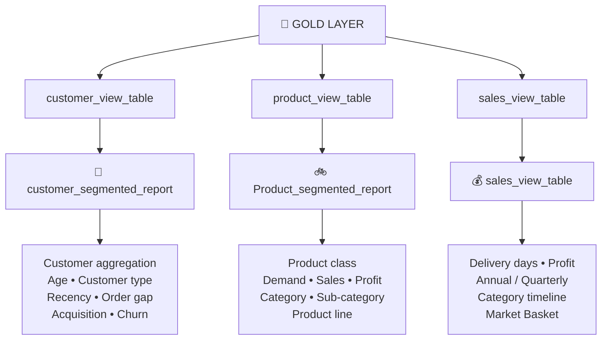
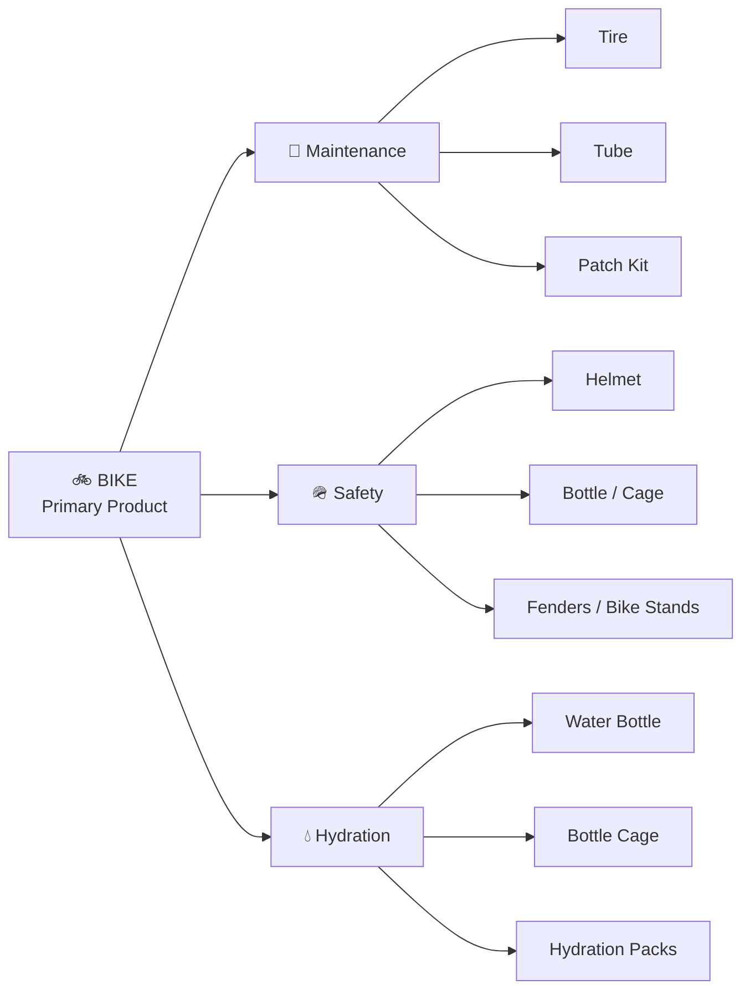
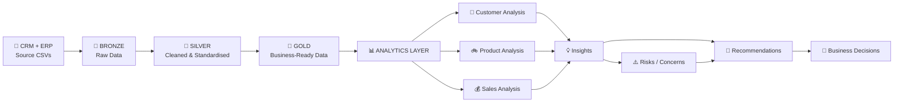

# 📊 AdventureWorks Bicycle Retail — Advanced Analytics & Insight Reports

<div align="center">

### **From Data → Analysis → Insight → Business Impact → Recommendation → Action**


</div>

> **advance anlytics make detailed postmortem of company data and extract insights from data. it make in-depth examination of data via multi-dimensional analysis methods to gather insights from data and built a reports based on all analysis. it figures out all business questions, point out trends, patterns and vigil management about any risk/concern identified during anlysis.**

---

# 🧭 01 — ANALYTICS OVERVIEW

The analytics layer is the final analytical stage of this data warehouse project.

Cleaned and standardised data is imported from the **Gold Layer** and then examined through multiple analytical methods to understand customer behaviour, product performance, sales trends, profitability, cross-selling and business risks.

The analysis is broadly divided into **three channels**:

| Channel | Focus | Master Table |
|---|---|---|
| 👥 **Customer Specific Analysis** | Customer behaviour, spending, demographics, acquisition and churn | `customer_segmented_report` |
| 🚲 **Product-wise Analysis** | Product demand, product grading, categories, profitability and product-line performance | `Product_segmented_report` |
| 💰 **Complete Sales Analysis** | Sales timeline, category performance, cross-product behaviour and product affinity | `sales_view_table` |

### 🔎 Analytical Philosophy

```text
                         GOLD LAYER
                             │
                             ▼
                 ┌─────────────────────┐
                 │ ANALYTICS EXPLORATION│
                 └──────────┬──────────┘
                            │
        ┌───────────────────┼───────────────────┐
        ▼                   ▼                   ▼
   👥 CUSTOMER          🚲 PRODUCT           💰 SALES
   Behaviour            Performance          Performance
        │                   │                   │
        └───────────────────┼───────────────────┘
                            ▼
                  MULTI-DIMENSIONAL
                     ANALYSIS
                            │
          ┌─────────────────┼─────────────────┐
          ▼                 ▼                 ▼
       Trends            Patterns           Risks
          │                 │                 │
          └─────────────────┼─────────────────┘
                            ▼
                     KEY FINDINGS
                            │
                     BUSINESS IMPACT
                            │
                      RECOMMENDATION
                            │
                            ▼
                     BUSINESS ACTION
```

---

# 🎯 02 — OBJECTIVE / BUSINESS QUESTIONS

## Core Analytical Objectives

1. **database and measures Exploration**
2. **Magnitude and ranking**
3. **Change-Over-Time Analysis**
4. **Cumulative analysis**
5. **Performance Analysis**
6. **Part-To-Whole anlysis**
7. **Data segmentation**
8. **Reporting**
9. **Advance analytics → Churn rate, Acquisition rate, Product Affinity analysis, Pareto Analysis**

## Major Business Questions

### 👥 Customer Perspective

- Who are the highest-value customers?
- Does higher order frequency mean higher customer spending?
- What percentage of customers are new, regular, low-value, big spenders and VIP?
- Where are customers geographically concentrated?
- Which customer demographic contributes most to sales?
- What is the spending distribution across customers?
- How frequently do customers return?
- What is the customer lifespan?
- How long has it been since the last order?
- What is the customer acquisition rate?
- What is the customer churning rate?
- Which customer groups require stronger retention strategies?

### 🚲 Product Perspective

- Which products drive revenue?
- Which products drive unit demand?
- Which products are premium, volume drivers, average performers or underperformers?
- Which products have the highest profit?
- Which products have the highest profit margin?
- Which product categories dominate sales?
- Which sub-categories accelerate category growth?
- Which sub-categories are underperforming?
- Which product line drives revenue?
- Which product line drives profitability?
- Where is customer demand concentrated?
- Where does product concentration risk exist?
- Are complementary products growing alongside Bike sales?

### 💰 Sales Perspective

- How has business performance changed over time?
- Which year represents the strongest growth phase?
- Which quarter performs best?
- Did sales growth translate into profit growth?
- Which categories are driving growth?
- How dependent is the business on Bikes?
- How many orders contain multiple products?
- Which products are frequently purchased together?
- Which secondary products have higher chances of sale with premium bikes?
- What are the strongest cross-selling opportunities?
- Which product ecosystems exist around Bike purchases?

---

# 🧱 03 — ANALYTICS MASTER TABLES

The analytics layer imports cleaned and standardised data from the Gold Layer and creates custom master tables containing **derived columns, calculated measures and business-rule based classifications** for visualization and insight reporting.



### Customer Master Table

`customer_segmented_report` is used for **visualization, insight reporting and interactive dashbord**.

It includes:

- customer-wise aggregation metrics
- age
- age-group
- customer type
- total orders
- total quantity
- total sales
- average order value
- first order date
- last order date
- customer lifespan
- recency
- average order gap
- country
- acquisition rate
- churn rate

The master table excludes **19 orders that have no order date**.

### Product Master Table

`Product_segmented_report` contains:

- average/unit price
- production period
- total orders
- total units sold
- total sales
- total cost
- profit
- product class
- product category
- sub-category
- product line

The master table excludes **19 orders that have no order date**.

### Sales Master Table

`sales_view_table` contains:

- order number
- order date
- ship date
- due date
- delivery days
- customer details
- country
- product category
- product sub-category
- product name
- product cost
- quantity
- price
- total sales
- profit

---

# 📌 04 — KPI REFERENCE

## 👥 Customer KPIs

| KPI | Business Meaning |
|---|---|
| Total Orders | Customer purchase activity |
| Total Quantity | Product quantity purchased |
| Total Sales | Customer contribution to revenue |
| Average Order Value | Customer-wise total sales / total orders |
| Customer Lifespan | Time between first and last order |
| Recency | Time difference between last order date and current date |
| Average Order Gap | Average time between customer orders |
| Customer Type | Business-rule based customer classification |
| Acquisition Rate | New customers added over time |
| Churning Rate | Customers not returning in the following year |

## 🚲 Product KPIs

| KPI | Business Meaning |
|---|---|
| Total Units Sold | Product demand |
| Total Orders | Product transaction activity |
| Total Sales | Revenue contribution |
| Profit | Direct financial contribution |
| Profit % | Profitability efficiency |
| Unit Price | Average selling price |
| Product Class | Business-rule based product performance |
| Production Period | Product selling period |
| Revenue Share | Contribution to category / business revenue |

## 🚴 Product-Line KPIs

| KPI | Business Meaning |
|---|---|
| Total Units Sold | Customer demand generated by a product line |
| Unit Share % | Contribution to overall bike demand |
| Total Sales | Revenue generated by product line |
| Revenue Share % | Contribution to total bike revenue |
| Total Profit | Absolute value created by product line |
| Profit Share % | Contribution to total bike profit |
| Average Selling Price (ASP) | Average price paid per bike |
| Revenue Efficiency | Ability to generate revenue from available demand |
| Profit Efficiency | Ability to convert sales into profit |

## 💰 Sales KPIs

| KPI | Business Meaning |
|---|---|
| Total Units Sold | Total customer demand generated |
| Quantity % | Contribution to overall volume |
| Total Sales | Revenue generated during the period |
| Sales % | Contribution to total business revenue |
| Total Profit | Financial value created after costs |
| Profit % | Contribution to total business profit |
| Revenue Productivity | Revenue generated from demand volume |
| Profit Productivity | Profit generated from revenue growth |
| Mutual Orders | Number of orders in which both products were purchased together |
| Cross-Sell Opportunity | Potential to recommend associated products |
| Bundle Potential | Opportunity to create combined offerings |
| Basket Driver | Product repeatedly appearing across top combinations |

## 🛒 Cross-Product KPIs

| KPI | Business Meaning |
|---|---|
| Accessories Units per Bike | Number of accessories purchased for every bike sold |
| Clothing Units per Bike | Number of clothing products purchased for every bike sold |
| Accessory Sales per Bike | Accessory revenue generated per bike sold |
| Clothing Sales per Bike | Clothing revenue generated per bike sold |
| Cross-Sell Intensity | Strength of customer adoption of complementary products |

---

# 👥 05 — CUSTOMER-SPECIFIC ANALYSIS

> **This section prioritises more on customers influence on sale by analysisng their pattern like spending range, geographic distribution etc.**

## Master Table — `customer_segmented_report`

### Customer Aggregation Metrics

The master table includes customer-wise:

- total orders
- total quantity
- total sales
- average order value

**Formula:**

`Average Order Value = Customer-wise Total Sales / Total Orders`

### Customer Lifespan

Customer lifespan is calculated as the difference between the customer's first and last order date.

### Recency

Recency measures the time difference between the customer's last order date and the current date.

### Average Order Gap

Average order gap is calculated by finding the sum of months difference of previous order of each customer divided by each customer's total orders.

### Age

Birthdate is transformed into customer age using the current date and birth date.

---

## 🏷️ Customer Classification

| Business Rule | Customer Type |
|---|---|
| `total_sales > 2500` AND `order_frequency > 10` | ⭐ VIP |
| `total_sales > 5000` | 💎 Big Spenders |
| `total_sales > 100` AND `order_frequency > 1` | 🔁 Regular |
| `total_sales <= 100` AND `order_frequency > 1` | 📦 Low-value customers |
| `order_frequency = 1` | 🆕 New Customers |

---

## 🔑 KEY FINDING 01 — Regular Customers Dominate the Customer Base

### 💡 Insight

> **Regular Customers → with 44% + of total customers is most frequent type in customer cat.**

VIP customers are very least with only **0.29% of total customers**.

### ⚠️ Business Impact / Consequence

The customer base is heavily dependent on regular customers rather than a large VIP population. This means the business has a broad repeat-customer base but a relatively small group of exceptionally high-value customers.

### 🎯 Recommendation

Focus on moving suitable regular customers toward higher-value and more frequent purchasing behaviour through targeted offers, bundles and premium-product recommendations.

---

## 🔑 KEY FINDING 02 — Big Spenders Create Disproportionate Revenue

### 💡 Insight

> **Big spenders though only comprises 9% of total customers but contribute 36% of total sale**

### ⚠️ Business Impact / Consequence

A relatively small customer segment contributes a disproportionately large share of revenue.

This creates a valuable customer segment but also creates concentration risk if high-value customers are not retained.

### 🎯 Recommendation

Protect and develop high-value customers while improving conversion of regular customers into higher-value repeat customers.

---

## 🔑 KEY FINDING 03 — Customer Concentration Is Visible Geographically

### 💡 Insight

> **More than half (55%) of total customers comes from just 2 locations – USA & Australia**

Germany and France have reported least sale → less than 10 % as compare to other countries like USA with **33.9% of total customers**.

> **Canada has lowest avg_cust_spending despite higher no. of customers visiting store fom this location indicates that customer here more prefers buying cheaper goods**

### ⚠️ Business Impact / Consequence

The business is geographically concentrated. Strong dependence on a small number of countries means changes in demand, competition, economic conditions or customer behaviour in those locations can have an outsized effect.

Canada's lower average customer spending also suggests that customer volume alone does not guarantee equivalent revenue contribution.

### 🎯 Recommendation

Investigate country-wise product mix and spending behaviour before applying a common marketing strategy across all regions.

---

## 🔑 KEY FINDING 04 — Majority of Customers Spend in Low-to-Moderate Range

### 💡 Insight

> **75% of customers spending range between $ 2 – $ 2500 i.e. majority of people are spending on low to moderate range project**

Only **25% of customers are spending on high grade products i.e. $2500+**.

### ⚠️ Business Impact / Consequence

The majority of customers are positioned in the low-to-moderate spending range, while a smaller segment drives high-value purchases.

### 🎯 Recommendation

Use the low-to-moderate customer base as an opportunity for upselling and cross-selling rather than relying only on premium-product buyers.

---

## 🔑 KEY FINDING 05 — Order Frequency Does Not Equal Customer Value

### 💡 Insight

| Finding | Observation |
|---|---:|
| New customers | **13.5%** |
| Customers placing >10 orders | **<1%** |
| Customers returning after their 1st order | **99%** |

> **Max orders does not mean higher customer spending.**

Examples:

| Customer Behaviour | Orders | Sales |
|---|---:|---:|
| Maximum orders | **68** | **$1,616** |
| Maximum sale | **9** | **$13,489** |

### ⚠️ Business Impact / Consequence

Order frequency and customer monetary value are different dimensions. A customer can place many low-value orders while another customer can generate much higher revenue through fewer premium purchases.

### 🎯 Recommendation

Customer segmentation should use both **frequency and monetary value**, rather than treating order count as the sole indicator of customer importance.

---

## 🔑 KEY FINDING 06 — Customer Return Gap Shows a Retention Concern

### 💡 Insight

> **Only 20.25% of customers return to store within year**

### 🔎 Reason

> **Hige gap in customer returning rate indicates that less customers are taking interest on our products and come back to store. But there may be another positive reason that → product are of great quality and have all-rounder feature that customers don’t need to come back for maintenance or purchasing accessories or any add-on with bikes. Because of premium nature of bikes customers do not require to make furthus investment in in complementary goods**

### ⚠️ Business Impact / Consequence

Low annual return frequency can indicate weak customer retention, but it should not automatically be treated as churn without considering product durability, replacement cycles and the nature of premium bicycle purchases.

### 🎯 Recommendation

Separate true customer churn from **long product replacement cycles** and investigate whether customers are inactive because they are dissatisfied or because the purchased products do not require frequent replacement.

---

## 🔑 KEY FINDING 07 — Customer Demographics Influence Sales

### Age

#### 💡 Insight

> **Age-wise: population of age-group 40-55 represent more than 50% of sales**

> **70+ age-group people are least contributors in total sales**

### ⚠️ Business Impact / Consequence

The 40–55 customer group represents the strongest commercial opportunity, while 70+ contributes the least.

### 🎯 Recommendation

Prioritise product communication and promotional strategies around the needs and preferences of the strongest age group while investigating whether the 70+ segment requires different product positioning.

### Gender

#### 💡 Insight

> **Both gender are equally contributing in total orders. Male group shows slight more interst as compare to female in store**

### ⚠️ Business Impact / Consequence

The business does not show an extreme gender imbalance in order participation.

### Marital Status

#### 💡 Insight

> **Majority of the customers, coming to store are married as 51.7% of total sale comes from these group.**

Singles have only placed **8.5K orders** as compared to married → **10.01K Orders**.

### ⚠️ Business Impact / Consequence

Married customers form the stronger sales and order segment and may represent an important target group for household-oriented or higher-value purchases.

---

## 🔑 KEY FINDING 08 — Customer Acquisition Rate

### 💡 Insight

> **Year 2010 & 2014 records lowest new customers addition because sales data starts in ‘DEC 2010’ and ends data in ‘JAN 2014’. Therefore, only partial data available for 2010 and 2011**

> **Year 2013 is the only year where highest number of new customers added.**

> **Customer addition is taking place at positive rate if we compare from previous years**

### ⚠️ Business Impact / Consequence

2013 represents the strongest customer acquisition period and aligns with the strongest overall sales-growth phase.

### 🎯 Recommendation

Use the customer acquisition pattern of 2013 as a benchmark and investigate which products, promotions, quarters and customer segments contributed to the acquisition acceleration.

---

## 🔑 KEY FINDING 09 — Customer Churning Rate

### 💡 Insight

> **Only customers of 2012 have lowest churning rate → 8.8 % only.**

> **Rest years, 90%+ Churn rate has been reported (Not a good thing)**

### ⚠️ Business Impact / Consequence

A 90%+ annual non-return rate in most cohorts is a major customer-retention concern if the metric represents genuine churn rather than long replacement cycles.

### 🔎 Analytical Note

The SQL churn calculation is an annual non-return measure: customers purchasing in year `Y` but not returning in `Y+1`.

### 🎯 Recommendation

Investigate the reason for non-return by separating:

- genuine dissatisfaction
- product durability
- replacement cycle
- lack of cross-selling
- geographic / customer differences

---

# 🚲 06 — PRODUCT-WISE ANALYSIS

> **This section prioritises more on Products and its categories performance. it aims to observe trends, pattern and its impact on sale.**

## Product Master Table — `Product_segmented_report`

The master table contains:

- average/unit price
- production period
- total orders
- total units sold
- total sales
- total cost
- profit
- product class
- product category
- sub-category
- product line

---

## 🏷️ Product Classification

| Product Class | Total Sales | Order Demand | Business Meaning |
|---|---|---|---|
| ⭐ **Star Product** | High (>100000) | High (>100) | Strong revenue and strong demand |
| 💎 **Premium Product** | High (>50000) | Low/Moderate | Generates high revenue despite fewer orders |
| 📦 **Volume Driver** | Low/Moderate | High (>500) | Frequently purchased but lower revenue contribution |
| 📈 **Avg. Performer** | Moderate (>10000) | Moderate | Stable performer with average sales and demand |
| ⚠️ **Underperformer** | Low (<10000) | Low | Weak sales and weak demand |

### 💡 Insight

> **Average performer and Star product have major share in total product list**

> **Great!! thing is underperming products has very low weightage in sale**

### ⚠️ Business Impact / Consequence

The low contribution of underperformers limits their direct revenue impact, but persistent weak products can still consume inventory, working capital and operational resources.

---

## 🔑 KEY FINDING 01 — Product Sales Distribution Is Highly Skewed

### 💡 Insight

> **Huge gap between mean and median indicates high positive skewness in products ordered which mean cheaper products dominates total sales.**

> **Whereas, small set of premium products pull average products ordered to doubled (2X)**

> **75% of total products have fewer orders i.e. below 500 orders, despite max orders of 4000+ of certail products**

### ⚠️ Business Impact / Consequence

A small group of highly demanded products strongly influences the average. Therefore, mean alone can hide the actual distribution of product demand.

### 🎯 Recommendation

Use median, quartiles and distribution bands together with averages when evaluating product performance.

---

## 🔑 KEY FINDING 02 — Product Sales Range

### 💡 Insight

Product-wise total sales range between **$2.4K and $13.7L**.

> **Despite that, 60% of all products total sales range are limited to $100000**

### ⚠️ Business Impact / Consequence

A relatively small group of products contributes a substantial portion of total product sales, creating product concentration.

---

## 🔑 KEY FINDING 03 — Demand Is Concentrated in a Small Number of Products

### 💡 Insight

| Product | Units Sold |
|---|---:|
| 🥇 Water Bottle - 30 oz. | **4,249** |
| 🥈 Patch Kit/8 Patches | **3,191** |
| 🥉 Mountain Tire Tube | **3,096** |
| Sport-100 Helmet Red | **2,230** |
| AWC Logo Cap | **2,190** |

Lowest selling product:

**Mountain-100 Silver-48 → 36 units**

### Important Comparison

> **Though Mountain-100 Silver-48 has lowest sale but because it is high value product → $ 3400 per unit and total sale → $ 122,400 as compare to Water Bottle - 30 oz. → $ 5 per unit only and total sale → $ 21,245. So, both are different class of product so cant be compared**

### Pareto Observation

- Only **3 products** sold 3,000+ units.
- **1/3rd** of the products per unit sale is below 100 Units.
- **79%** of products demand lies below 500 Units.

### ⚠️ Business Impact / Consequence

Unit demand and revenue are different dimensions. Low-priced accessories can dominate units while premium bikes dominate revenue.

---

## 🔑 KEY FINDING 04 — Product Distribution

### 💡 Insight

> **all range of products are equally distributed as cheaper, mid-range and premium products**

This indicates that the product portfolio contains products across different price bands.

---

## 🔑 KEY FINDING 05 — Product Grading Reveals Mid-Range Weakness

### 💡 Insight

> **73.8 % of total orders belongs to cheaper product grade**

> **Mid-range products had reported lowest sale. It require actions to be taken to increase sale of mind-range products**

> **Premium product has more demand then mid-range products**

> **Accessories & clothing categories of products don’t account for expensive or premium products**

> **Bikes Category can be called as premium grade products**

### ⚠️ Business Impact / Consequence

Premium Bike products are the largest revenue source despite lower unit demand. This creates a strong dependence on high-value Bike sales.

> **Risk: Any downfall in sale of premium products or sale of bike categories would amout to huge fall revenue because of its heavy margin in total sale → shows dependency**

At the same time, this can also be interpreted as the core business model because the store primarily focuses on Bike products.

### 🎯 Recommendation

Develop mid-range products and complementary categories while maintaining premium Bike inventory and demand.

---

# 🏆 PRODUCT CATEGORY PERFORMANCE

## Business Questions

- How has category dependence changed over time?
- Which categories drove business growth?
- Did secondary products grow alongside bike sales?
- Is the business becoming more diversified or remaining bike-dependent?
- How sub-category helps in accelerating growth of any categories?
- Which sub-categories are underperforming and restricting any categories growth?

### Scope

**2011–2013 only.**

Partial data for **2010 & 2014** are excluded from trend evaluation.

> **Clothing and accessories categories cannot be compared with bike category because of later category is high value expensive products. Hence, it has no match with other categories.**

---

# 🧩 ACCESSORIES CATEGORY

## 🔑 KEY FINDING — Accessories Are the Volume Engine

### 💡 Insight

> **despite having less contribution in total revenue(2.4%) it become best performers in terms of total units sold, accounting for 59.8% of all units sold → For every 100 products sold, approximately 60 were Accessories.**

### 2012 → 2013 Expansion

| Year | Units Sold |
|---|---:|
| 2012 | **106** |
| 2013 | **34.4K** |

> **Accessories experienced the most dramatic expansion between 2012 and 2013.**

In 2013 alone, Accessories represented **58.9% of total units sold** and sold more units than Bikes and Clothing combined.

### Customer Behaviour Insight

- Strong indication that customers frequently purchase multiple accessory items.
- Accessories appear to be low-cost, repeat-purchase products.
- Likely purchased as add-ons alongside bike purchases.

### ⚠️ Business Impact / Consequence

Accessories provide:

- frequent purchase behaviour
- excellent cross-selling opportunity
- customer retention opportunity
- high unit-volume contribution

---

## 🔑 KEY FINDING — Accessories Revenue Is Concentrated

### 💡 Insight

> **Tires and Tubes and Helmets together contribute 67.12% of Accessories sales.**

### ⚠️ Business Impact / Consequence

Heavy revenue concentration in two subcategories means constant stock availability is necessary.

### Volume Leaders

| Sub-category | Unit Share |
|---|---:|
| Tires and Tubes | **48.01%** |
| Bottles and Cages | **22.14%** |
| Helmets | **17.84%** |

> **Tires and Tubes lead both sales volume and revenue → strong commercial importance.**

### Low Price but High Volume — Bottles and Cages

> **Bottles and Cages have an average price of 7 but contribute 8.14% of sales.**

Their relatively high sales volume makes them valuable products to monitor for availability and repeat purchases.

### Premium Products, Lower Volume

| Sub-category | Sales Share |
|---|---:|
| Bike Stands | **5.65%** |
| Bike Racks | **5.62%** |

Their higher prices compensate for lower unit sales.

### Weakest Accessories Sub-category

> **Cleaners contribute only 1.04% of sales and also rank bottom in the rank**

### 🎯 Recommendation

> **More advertisement and branding of this product is required to increase its sale as despite lowest ranking, total orders places for this product stills better than hydration packs, bike stands, bike racks**

### Fenders — Product-Mix Opportunity

> **Fenders contribute 5.87% of units sold but 6.66% of sales.**

Revenue share exceeds unit share, suggesting a higher realised selling price relative to the category mix.

### 🚀 Growth

> **Accessories Experienced Hyper-Growth and Became the Company's Largest Volume Category → 324x growth ↑**

---

# 🚲 BIKES CATEGORY

## 🔑 KEY FINDING — Bikes Are the Core Business Driver

### 💡 Insight

> **Bikes contribute 96.4% of total revenue. → Core business driver**

> **company's financial performance is overwhelmingly dependent on Bike sales.**

> **Any improvement or decline in Bike performance will directly impact total business revenue.**

### ⚠️ Business Impact / Consequence

Close monitoring of stock is essential. Otherwise a large Bike-sales decline could create a huge revenue fall.

---

## 🔑 KEY FINDING — Bikes Remained the Growth Backbone, But Revenue Productivity Declined Before Exploding in 2013

| Year | Units Sold | Sales | Profit |
|---|---:|---:|---:|
| 2011 | **2.2K** | **$7.08M** | **$2.82M** |
| 2012 | **3.3K** | **$5.84M** | **$2.05M** |
| 2013 | **9.7K** | **$15.35M** | **$6.21M** |

### 2011 → 2012

- Units Sold ↑ **47.5%**
- Sales ↓ **17.4%**
- Profit ↓ **27.2%**

### 💡 Insight

Despite selling more bikes, the business generated less revenue and profit.

### ⚠️ Business Impact / Consequence

Higher volume alone did not create higher business value.

### 2012 → 2013

- Units Sold ↑ **196.8%**
- Sales ↑ **162.8%**
- Profit ↑ **202.4%**

### 💡 Insight

2013 restored both scale and profitability.

### ⚠️ Business Impact / Consequence

> **Bikes remain the undisputed business driver. However, 2012 showed that higher sales volume alone doesn't guarantee higher business value. The real breakthrough occurred in 2013 when both volume and profitability scaled simultaneously.**

---

# 🚴 ROAD BIKES

## 🔑 KEY FINDING — Road Bikes Are the Company's True Financial Booster

### 💡 Insight

> **Although Mountain Bikes lead in unit sales, Road Bikes dominate both revenue and profitability.**

- Road Bikes generated **$14.6M revenue**
- Road Bikes generated **$5.37M profit**
- Revenue Share → **50.9%**
- Profit Share → **47.1%**

> **This means: Every $1 generated from Bikes, approximately $0.51 comes from Road Bikes.**

> **Nearly 1 out of every 2 profit dollars originates from Road products.**

### ⚠️ Business Impact / Consequence

Road Bikes are not merely another product line; they are the **primary financial pillar supporting the bike business**.

Any pricing, inventory, or demand fluctuation within Road Bikes will have the greatest impact on overall Bike performance.

### 🎯 Recommendation

- **Consitent maintenance of road bike inventory to catch uneven demand fluctuation**
- **Stable pricing to avoid sudden customer churning**
- **Restructuring touring bike sale strategy to boost its sale**

---

# ⛰️ MOUNTAIN BIKES

## 🔑 KEY FINDING — Mountain Bikes Win Customer Demand but Lose Revenue Leadership

### 💡 Insight

> **Mountain Bikes account for 45.6% of all bike units sold but generate only 35.7% of bike revenue.**

- Mountain Bikes → **16.9K units**
- Road Bikes → **15.6K units**
- Road Bikes generated **43% more revenue**
- Mountain Bike sales → **$10.3M**

### Reason

Road Bike average selling price → **$940**

Mountain Bike average selling price → **$607**

> **Road Bikes are priced approximately 1.55× higher than Mountain Bikes**

### ⚠️ Business Impact / Consequence

Mountain Bikes effectively act as the **volume driver**, bringing customers into the business at lower average price points.

---

## 🔑 KEY FINDING — Road Bikes Generate More Revenue with Fewer Sales

### 💡 Insight

> **Road Bikes sold 8% fewer units than Mountain Bikes Yet generated 43% more revenue and 18% more profit**

### ⚠️ Business Impact / Consequence

This is one of the strongest indicators of pricing power within the product portfolio.

Road Bike customers show higher willingness to spend.

---

## 🔑 KEY FINDING — Profit Distribution Is More Balanced Than Revenue Distribution

| Product Line | Revenue Share | Profit Share |
|---|---:|---:|
| Road | **50.9%** | **47.1%** |
| Mountain | **35.7%** | **39.9%** |
| Touring | **13.5%** | **13.0%** |

### 💡 Insight

Mountain Bikes generate **4.2 percentage points more profit share than revenue share**.

This means Mountain Bikes convert revenue into profit more efficiently than Road Bikes.

### ⚠️ Business Impact / Consequence

- Road Bikes create revenue leadership.
- Mountain Bikes create profitability stability.
- Together they form a highly balanced business portfolio.

### 🎯 Recommendation

Maintain investment across both segments rather than over-focusing on Road Bikes due to revenue alone.

---

# 🧳 TOURING BIKES

## 🔑 KEY FINDING — Touring Bikes Contribute Only Around 13%

### 💡 Insight

Touring Bikes contribute:

- **12.4% of unit demand**
- **13.5% of revenue**
- **13.0% of profit**

The entire Touring segment generates approximately:

- **$3.88M revenue**
- **$1.48M profit**

This is nearly:

- **3.8× smaller than Road Bikes** in profit generation
- **3.1× smaller than Mountain Bikes** in profit generation

### ⚠️ Business Impact / Consequence

Touring Bikes currently play a supporting role rather than a growth-driving role.

However, performance remains relatively proportional across demand, revenue and profit.

### Reason

This indicates smaller market demand rather than necessarily an underperforming category.

### Price Comparison

| Product Line | Average Price |
|---|---:|
| Road | **$940** |
| Touring | **$845** |
| Mountain | **$607** |

### 🔑 KEY FINDING — Road Bikes Command a Premium Market Position

Road Bikes command:

- **55% higher prices than Mountain Bikes**
- **11% higher prices than Touring Bikes**

---

# 👕 CLOTHING CATEGORY

## 🔑 KEY FINDING — Clothing Achieved Significant Growth but Failed to Scale Commercially

### 💡 Insight

> **Clothing showed exceptional volume growth → 395× increase**

Although Clothing became a meaningful volume contributor, its financial impact remained limited.

### ⚠️ Business Impact / Consequence

Clothing successfully attracted customers but failed to generate comparable revenue growth.

This suggests Clothing currently functions more as a supporting category than a strategic revenue pillar.

### 🎯 Recommendation

Evaluate:

- Premium apparel opportunities
- Product pricing strategy
- Category profitability
- Customer demographics

to determine whether revenue potential remains underutilized.

---

## Clothing Sub-Category Findings

### Jerseys

> **Jerseys dominate the category: Generate 50.95% of sale alone in clothing category and also the most units sold product → 36.61% of units sold. → All-rounder subcategory**

### Shorts

> **Shorts are the second-largest revenue contributor: Generate 71,330 (21.00%) of sales**

- Average price = **70**
- Highest among listed clothing products
- Total units sold is less than Jerseys, Gloves and Cap

This means higher value compensates for lower unit sales.

### Gloves

> **Gloves lead in unit volume after Jerseys: Sell 1,430 units (15.70%) despite contributing 10.10% only of sales in clothing category**

This is consistent with their lower average price of **24**.

### Socks

> **Socks are the weakest contributor: Generate 5,112 (1.50%) of sales and account for 6.24% of units sold.**

---

# 🔄 BUSINESS TRANSITION — FROM BIKE SELLING TO CYCLING ECOSYSTEM

## 2011 Business Structure

| Category | Sales Share |
|---|---:|
| Bikes | **100%** |

## 2013 Business Structure

| Category | Sales Share |
|---|---:|
| Bikes | **52.5%** |
| Accessories | **2.3%** |
| Clothing | **1.1%** |

At the same time:

- Accessories became the largest volume category.
- Clothing emerged as a meaningful support category.

### 💡 Insight

The business evolved from:

> **"Selling Bikes"**

to:

> **"Supporting the Entire Cycling Journey"**

through:

- Accessories
- Apparel
- Repeat-purchase products

### ⚠️ Business Impact / Consequence

The business began creating additional revenue streams beyond the primary Bike category, but Bike revenue concentration remains very high.

---

# 💰 07 — PRODUCT PERFORMANCE ANALYSIS

## 🔑 KEY FINDING 01 — Mountain-200 Dominates Product Revenue

### 💡 Insight

> **Mountain bike sub-category alone is dominating top 6 position in total sales revenue → 27.73 % of total sales.**

Top six:

| Product | Sales |
|---|---:|
| Mountain-200 Black-46 | **$1.37M** |
| Mountain-200 Black-42 | **$1.36M** |
| Mountain-200 Silver-38 | **$1.33M** |
| Mountain-200 Silver-46 | **$1.30M** |
| Mountain-200 Black-38 | **$1.29M** |
| Mountain-200 Silver-42 | **$1.25M** |

### 💡 Insight

Mountain-200 is a premium product because though it is not top selling in units, its high value and huge demand (500+ units) make it a high-revenue Bike model.

> **Therefore it represents AdventureWorks' flagship product range**

### 🎯 Recommendation

Ensure consistency in its promotion and proper stock maintenance.

### Additional Finding

Road-150 model is the second best performing Bike model in terms of total sales revenue.

> **In all 130 products ranking, top 77 positions are secured by Bikes category**

This means Bikes sales is the primary driver of sales revenue.

---

## 🔑 KEY FINDING 02 — Bottom Products Are Not Automatically Bad Products

### 💡 Insight

> **Bottom 80 Products cant able to represent even 10% of total sales revenue**

Clothing categories mainly and Accessories in some cases are responsible for such low contribution.

Some low-contributing products include:

- Socks
- Tires And Tubes
- Gloves
- Vests

### Important Analytical Caution

> **But, this does not mean they are worst seller. Infact, many products in there have good sales → 100+ units. Just because these are low value product, do not mean to declare worst performers.**

### ⚠️ Business Impact / Consequence

Revenue ranking alone can incorrectly classify low-priced, high-volume products as poor performers.

### 🎯 Recommendation

Further examination should include:

- total orders
- units sold
- profit
- profit margin
- product category
- cross-selling role

---

# 📦 VOLUME ORDER ANALYSIS

## 🔑 KEY FINDING — Small Accessories Dominate Transaction Counts

| Product | Units Sold |
|---|---:|
| Water Bottle - 30 oz. | **4,249** |
| Patch Kit/8 Patches | **3,191** |
| Mountain Tire Tube | **3,096** |
| Sport-100 Helmet Red | **2,230** |
| AWC Logo Cap | **2,190** |

> **The above top 5 products belongs to accessories**

### 💡 Insight

Customers purchase accessories repeatedly.

Because of consumable and low-cost products, they encourage frequent purchases.

> **Top 20 products (all of accessories category) secured 60% of total sales volume.**

### Main Product Types

- Bottles And Cages
- Tires And Tubes
- Helmets
- Caps
- Cleaners

### Bottom 60 Products

> **Bottom 60 Products → all belongs to Bike Category known for premium products contributes only 6% of total units sold**

### Mountain 500 and Mountain 100

Mountain 500 and Mountain 100 Bikes are least units sold products → **below 40 units**.

- Mountain-100 Silver-48 → lowest unit sold but high value → **$3,400** compensates revenue loss.
- Mountain-500 Silver-44 → unit price **$565** and underperforms in both total sales and units sold.

---

# 💵 PROFITABILITY ANALYSIS

## KPI Reference

| KPI | Business Meaning |
|---|---|
| Total Profit | Sales − Cost; direct financial contribution |
| Profit % | Profit ÷ Sales × 100; measures profitability efficiency |

---

## 🔑 KEY FINDING 01 — Minimum Product Profitability Is 22%

### 💡 Insight

- Minimum profit earned by any product → **22%**
- **32/130 products** cost is less than profit → **profit >50%**
- Sub-categories with >50% profit:
  - Tires And Tubes
  - Bottles And Cages
  - Socks
  - Fenders
  - Bike Stands

---

## 🔑 KEY FINDING 02 — Bikes Win in Profit per Unit, Accessories Win in Margin

### 💡 Insight

> **Bike category outperforms other category in terms of per unit profit value → 730.65/U profit, 10 times higher then others**

But by profit margin:

> **Accessories has no competitor → 62.76%. even the bike category failed → 39%**

Clothing underperforms in both total sales by volume and profit value.

### ⚠️ Business Impact / Consequence

The business has two different profitability strengths:

- Bikes → high absolute profit per unit
- Accessories → high profitability efficiency / margin

---

## 🔑 KEY FINDING 03 — Accessories Deliver Exceptional Profit Margins Despite Low Revenue

Many accessory products generate **60%–75% profit margins**, substantially exceeding most Bike products.

| Product | Profit % |
|---|---:|
| Road Tire Tube | **75.00%** |
| Road Bottle Cage | **66.67%** |
| Sport Helmet Series | **62.86%** |
| Fender Set | **63.64%** |
| ML Road Tire | **64.00%** |

### Comparison

- Best Bike Margin ≈ **45%**
- Best Accessory Margin = **75%**
- Accessory margins are approximately **1.7× higher** than premium Bike margins.

### Reason

Accessories are low-cost products requiring comparatively smaller costs to generate sales.

### ⚠️ Business Impact / Consequence

Although accessories contribute relatively little revenue, they generate highly efficient profits.

The profitability potential per dollar invested is extremely attractive.

### 🎯 Recommendation

Increase accessory attachment rates with Bike purchases.

---

## 🔑 KEY FINDING 04 — High-Margin Products Are Not Always High-Profit Products

| Product | Profit Margin | Total Profit |
|---|---:|---:|
| Road Tire Tube | **75%** | **$7,128** |
| Mountain-200 Black-46 | **43.48%** | **$597K** |

> **Despite having almost half the margin, Mountain-200 generates 84× more profit.**

### Reason

Profit is driven by the combination of:

- Margin
- Revenue scale
- Demand volume

not margin alone.

### ⚠️ Business Impact / Consequence

Focusing solely on profit percentages can lead to incorrect business decisions.

---

## 🔑 KEY FINDING 05 — Road-150 Series Represents the Second Strongest Profit Engine

All Road-150 variants generated more than:

**$395K–$474K profit each**

Average margin → **39.32%**

Combined profit from Road-150 variants exceeds:

**$2.18 Million**

### Reason

Higher price positioning → **$3,578** offsets lower margins relative to Mountain-200 Bikes.

### ⚠️ Business Impact / Consequence

Road-150 provides strong diversification beyond the Mountain product family.

### 🎯 Recommendation

Identify markets where demand can be increased.

---

## 🔑 KEY FINDING 06 — Mountain-200 Family Dominates Absolute Profit

Top six profit-generating products are all from the Mountain-200 family.

### Combined Profit

**$3.46 Million**

| Product | Profit |
|---|---:|
| Mountain-200 Black-46 | **$597K** |
| Mountain-200 Black-42 | **$594K** |
| Mountain-200 Silver-38 | **$585K** |
| Mountain-200 Silver-46 | **$567K** |
| Mountain-200 Black-38 | **$566K** |
| Mountain-200 Silver-42 | **$548K** |

### Reason

- High selling prices → **$2,200+**
- Strong demand → **560–620 units sold**
- Consistent margins → **~43.5%**

### ⚠️ Business Impact / Consequence

The company earns a significant portion of its profitability from a single product family.

This creates both:

- Strong competitive advantage
- Product concentration risk and overdependency

### 🎯 Recommendation

Continuously diversify profit generation through:

- Accessories
- Clothing
- Mid-tier Bike offerings

---

## 🔑 KEY FINDING 07 — Mountain Bikes Outperform Other Bike Segments in Profit Efficiency

Mountain Bike families consistently generate margins around **43%–45%**.

| Segment | Avg Margin |
|---|---:|
| Mountain Bikes | **43–45%** |
| Touring Bikes | **38%** |
| Road-150 Bikes | **39%** |
| Road-250 Bikes | **32–38%** |

### Reason

Mountain products achieve an effective balance between:

- Premium pricing
- Healthy demand
- Strong cost control

### ⚠️ Business Impact / Consequence

Mountain Bikes appear to be the most financially efficient category within the core Bike business.

### 🎯 Recommendation

Focus future product innovation and premium offerings around Mountain Bike lines.

---

## 🔑 KEY FINDING 08 — Clothing Shows Strong Margins but Weak Profit Impact

Several Clothing products generate **62%–67% profit margins**.

Examples:

- Women's Mountain Shorts → **62.86%**
- Half-Finger Gloves → **62.50%**
- Racing Socks → **66.67%**

However:

- Clothing → **$4K–$16K profit**
- Bike → **$500K profit**

### Reason

The constraint is **revenue scale**, not profitability efficiency.

### ⚠️ Business Impact / Consequence

Clothing has immense profit potential if demand can be increased, not in terms of current profit value contribution but through profit efficiency.

---

## 🔴 KEY FINDING 09 — Profit Concentration Risk Exists Within Premium Bike Families

### 💡 Insight

The majority of substantial profits come from:

- Mountain-200 Series
- Road-150 Series

Many other products contribute minimal profit despite strong margins.

### Reason

Large-value Bike sales dominate absolute profitability.

### ⚠️ Business Impact / Consequence

- Huge impact on company profit if even slight fall in premium Bike segments
- Competitive pressure in premium categories

### 🎯 Recommendation

> **continuously diversify profit generation through: Accessories, Clothing, Mid-tier bike offerings**

---

# 🔄 08 — CROSS-CATEGORY SALE ANALYSIS

This section aims to observe how the core segment category of the store (**Bikes**) has relation with complementary product categories → **Accessories and Clothing**.

## Objectives

- How many accessories and clothing items customers purchase for every Bike sold.
- How much secondary revenue each Bike customer generates.
- Whether customers become more engaged with complementary products over time.
- Which periods demonstrate stronger cross-selling effectiveness.

---

## 🔑 KEY FINDING 01 — Customers Spend More on Accessories Than Clothing

### 💡 Insight

> **Customers are more spending on accessories as compare to clothing segment $ 2 times**

### 2013

| Metric | Accessories | Clothing |
|---|---:|---:|
| Units per Bike | **3.55** | **1.00** |
| Sales per Bike | **$68.78** | **$33.36** |

Accessory adoption was therefore **3.5× higher** than Clothing adoption.

Accessory spending generated **2.1× more revenue** than Clothing spending.

### ⚠️ Business Impact / Consequence

Customers clearly view Accessories as a natural extension of their Bike purchase, whereas Clothing remains a secondary consideration.

Accessories appear to solve immediate ownership needs such as:

- Safety
- Maintenance
- Storage
- Riding convenience

### 🎯 Recommendation

Prioritize cross-sell initiatives around Accessories first because they demonstrate stronger customer acceptance and spending behaviour.

---

## 🔑 KEY FINDING 02 — Secondary Revenue Opportunity Is $102.14 per Bike

| Category | Sales per Bike |
|---|---:|
| Accessories | **$68.78** |
| Clothing | **$33.36** |
| **Total** | **$102.14** |

### 💡 Insight

Every Bike customer represents an additional **$102.14 revenue opportunity** from complementary products.

### ⚠️ Business Impact / Consequence

Secondary product sales can increase:

- Customer Lifetime Value
- Basket Size
- Revenue Diversification

and reduce dependency on Bike-only revenue.

---

## 🔑 KEY FINDING 03 — Massive Cross-Selling Breakthrough in 2013

| Year | Accessories per Bike | Accessory Sales per Bike |
|---|---:|---:|
| 2012 | **0.03** | **$0.66** |
| 2013 | **3.55** | **$68.78** |

### 💡 Insight

- Accessories purchased per Bike increased from **0.03 to 3.55**
- Customers bought **118× more accessories per Bike**
- Accessory spend per Bike increased from **$0.66 to $68.78**

For every Bike sold in 2013:

- **3.5 accessory items**
- **1 clothing item**

### ⚠️ Business Impact / Consequence

> **It suggests a major shift in customer buying behavior where customers moved from purchasing only bikes to purchasing complete cycling ecosystems.**

This is one of the strongest indicators of successful cross-selling.

### 🎯 Recommendation

Promote:

- Marketing campaigns
- Bundling strategies
- Retail promotions
- Store expansion

---

## 🔑 KEY FINDING 04 — Seasonal Cross-Selling Behaviour

### High Cross-Sell Months

| Month | Accessory Spend per Bike |
|---|---:|
| March | **$56.99** |
| January | **$55.46** |
| February | **$53.85** |
| April | **$52.72** |
| May | **$51.20** |

**Average → ~$54 per Bike**

### Low Cross-Sell Months

| Month | Accessory Spend per Bike |
|---|---:|
| December | **$39.32** |
| June | **$40.24** |
| November | **$41.82** |

**Average → ~$40 per Bike**

### 💡 Insight

Customers spend approximately **35–40% more on accessories during peak months** compared to low-spending periods.

### ⚠️ Business Impact / Consequence

Customer engagement with complementary products is not constant throughout the year.

There appear to be favourable spending periods where customers are more willing to invest in add-on products.

### 🎯 Recommendation

Concentrate:

- Bundle offers
- Helmet promotions
- Cycling gear campaigns

during months showing historically higher cross-sell behaviour.

---

## 🔑 KEY FINDING 05 — Clothing Spending Remains Remarkably Stable

Clothing spend per Bike fluctuates between:

- High → **$27.59**
- Low → **$18.74**
- Difference ≈ **47%**

Accessory spending ranges between:

- High → **$56.99**
- Low → **$39.32**
- Difference ≈ **45%**

However, Clothing purchases consistently remain around **$20–$27 per Bike** with approximately **1 Clothing item purchased per Bike** throughout the year.

### ⚠️ Business Impact / Consequence

Unlike Accessories, Clothing demand appears more predictable and less volatile.

---

## 🔑 KEY FINDING 06 — Bike Purchase Rarely Remains a Single-Category Transaction

### 💡 Insight

In 2013, for every Bike sold:

- **3.55 Accessories**
- **1 Clothing product**

This demonstrates customers are engaging with multiple categories after entering the store for shopping.

### Exception

> **2011 is the year where no secondary products like accessories and clothing have been purchased. Whereas bike records sale of 2216 units**

### ⚠️ Business Impact / Consequence

The business is not merely selling Bikes. The business is successfully creating:

> **A Cycling Product Ecosystem**

This increases:

- Customer Lifetime Value
- Basket Size
- Revenue Diversification

while reducing dependency on Bike-only revenue.

---

# 💰 09 — COMPLETE SALES ANALYSIS

> **In this section, we will explore customer orders patterns and how different categories of products and customers segments are performing on diverse timeline and also examine growth trends. This would help in making decision making to boost sale and also enable underperforming department to revise their performance**

## Sales Snapshot

| KPI | Value |
|---|---:|
| Total Orders | **60,398** |
| Total Distinct Orders | **27,659** |
| Distinct Orders with >1 Product Ordered | **17,991** |
| Sales Period | **Dec. 2010 → Jan. 2014** |

### Analytical Scope

2010 and 2014 are not considered in annual or quarterly trend analysis because the data is partial.

### Sales Master Table

`sales_view_table` includes:

- Delivery Days → `due_date - order_date`
- Profit → `total_sales - product_cost`

---

# 📈 ANNUAL & QUARTERLY SALES PERFORMANCE

## Objectives

This analysis examines how business evolved across years and quarters by evaluating:

- growth acceleration
- business turning points
- seasonal patterns
- operational trends

---

## 🔑 KEY FINDING 01 — 2013 Was the Company's Defining Growth Year

| Year | Unit Share | Sales Share | Profit Share |
|---|---:|---:|---:|
| 2011 | **3.8%** | **24.2%** | **24.3%** |
| 2012 | **5.8%** | **20.0%** | **17.7%** |
| 🚀 2013 | **90.4%** | **55.9%** | **58.1%** |

### 💡 Insight

- **90.4%** of all units sold occurred in 2013.
- **$16.3M** sales generated in 2013.
- **$6.76M** profit generated in 2013.
- More than **1 out of every 2 revenue dollars** was generated during 2013 alone.

### 🔎 Reason

- Q3 and Q4 reported steep rise in all KPIs: revenue, unit volumes and profits.
- Earlier customer acquisition analysis showed that in 2013 the company added the largest number of new customers → **67.75%**.
- New customers means more revenue, profit and product demand.

### ⚠️ Business Impact / Consequence

> **2013 represents the company's real growth phase and serves as the benchmark year for evaluating future performance.**

The business became substantially larger and more profitable compared to previous years.

---

## 🔑 KEY FINDING 02 — 2012 Sold More Products but Generated Less Business Value Than 2011

### 💡 Insight

Compared with 2011:

- Units Sold ↑ **53%**
- Sales ↓ **17%**
- Profit ↓ **27%**

### Reason

> **Accessories(complementary goods) which is also a low value products as compare to premium bike products shows largest sales of all years → 58.91% (34.4 K units)**

### ⚠️ Business Impact / Consequence

- Growth in volume alone does not guarantee business growth.
- The company experienced volume expansion but lost revenue productivity and profit productivity.

---

## 🔑 KEY FINDING 03 — 2013 Restored Both Scale and Profitability

| KPI | Change vs 2012 |
|---|---:|
| Units Sold | **15.5× Higher** |
| Sales | **2.8× Higher** |
| Profit | **3.3× Higher** |

### 💡 Insight

Sales Share = **55.9%**

Profit Share = **58.1%**

Profit share exceeded sales share.

### Reason

The company did not simply generate more revenue; it converted a larger portion of revenue into profit.

### ⚠️ Business Impact / Consequence

- Healthier growth quality
- Stronger profit generation
- Business became both larger and more financially efficient

### 🎯 Recommendation

Use 2013 as the benchmark year when evaluating future performance and profitability trends.

---

## 🔑 KEY FINDING 04 — Each Year Reached Peak Performance in Q4

### 💡 Insight

Across all complete years, **Q4 delivered the strongest performance**.

### ⚠️ Business Impact / Consequence

Customer spending appears to intensify toward year-end.

This suggests Q4 is the company's most important commercial period.

### 🎯 Recommendation

Allocate maximum support to Q4 through:

- Inventory readiness
- Promotions
- Premium Bike campaigns
- Accessory bundles

---

## 🔑 KEY FINDING 05 — 2013 Shows Highest Quarter-to-Quarter Growth Momentum

From Q1 → Q4 2013:

| KPI | Growth |
|---|---:|
| Sales | **99%** |
| Profit | **99%** |
| Units Sold | **74%** |

### ⚠️ Business Impact / Consequence

Growth was not concentrated in a single successful quarter, rather strengthened throughout the year.

This is a sign of healthy market demand rather than isolated promotional success.

---

## 🔑 KEY FINDING 06 — Q4 2013 Alone Generated More Revenue Than Entire Years of 2011 or 2012

### 💡 Insight

The scale of growth achieved in late 2013 fundamentally changed the size of the business.

### ⚠️ Business Impact / Consequence

The company entered a substantially larger revenue and demand phase, making late-2013 performance an important benchmark for future planning.

---

# 🧩 SALES CATEGORY ASSESSMENT ON TIMELINE

## 🔑 KEY FINDING — 2011 Had Only Flagship Product Sales

### 💡 Insight

> **2011 have witnessed only sale of flagship products: no sale of accessories and clothing(complementary products) had beed sold during 2011**

### Reason

> **Company’s core business is bike sale as the name suggest adventurework bicycle retai. So, Their main energy is to increase sale of bikes**

### ⚠️ Business Impact / Consequence

Only one category sale led to uneven revenue growth of different product categories.

Significant cost and expenses were incurred toward:

- manufacturing
- sourcing
- logistics

of Accessories and Clothing, but with zero sales velocity this creates:

- direct drain on profitability
- stagnant stock movement
- chances of obsoletion and depreciation
- stock holding cost such as tax, insurance and security expenses

### 🎯 Recommendation

Secondary-category inventory should be aligned with demonstrated customer demand and cross-selling potential rather than simply being maintained as standalone stock.

---

# 🛒 10 — MARKET BASKET / PRODUCT AFFINITY ANALYSIS

> **It aims observe products that are purchased together frequently within same orders, which means, it shares mutual relationship with each other**

## 🎯 Business Questions / Objective

- Highlight set of products are ordered together
- Which secondary products have higher chances of sale along with primary premium products.
- How customers are spending on utility products like – tire maintenance, safety equipment
- Which combination of products have highest cross sale opportunity?
- How many Share of orders containing more than one product??
- Which secondary products ( accessories and clothing ) can be used for promotional campaign for premium bike products?

## KPI Reference

| KPI | Description |
|---|---|
| Mutual Orders | Number of orders in which both products were purchased together |
| Cross-Sell Opportunity | Potential to recommend associated products |
| Bundle Potential | Opportunity to create combined offerings |
| Basket Driver | Product repeatedly appearing across top combinations |

---

## 🔑 KEY FINDING 01 — Mutual Products with Frequent Orders

### 💧 Water Bottles Are the Universal Attachment Product

> **The strongest product combinations involve the Water Bottle - 30 oz.**

| Combination | Mutual Orders |
|---|---:|
| Mountain Bottle Cage + Water Bottle | **1,692** |
| Road Bottle Cage + Water Bottle | **1,521** |
| AWC Logo Cap + Water Bottle | **626** |
| Helmet Red + Water Bottle | **382** |
| Helmet Black + Water Bottle | **365** |
| Helmet Blue + Water Bottle | **363** |

### 💡 Insight

The Water Bottle appears in most of the top basket combinations.

### ⚠️ Business Impact / Consequence

> **The Water Bottle acts as a "gateway accessory" across multiple customer segments.**

Most of the customers while ordering bottle cages, helmets and logo cap, are also highly likely to purchase a water bottle.

---

## 🔑 KEY FINDING 02 — 9.6% of Multi-Product Orders Show Bundle Potential

**1,728 orders** out of **17,991 distinct orders having more than 1 product ordered** show bundle potential.

> **9.6 % (1728 orders) of the total distinct orders having more than 1 product ordered (17991 orders ) shows bundle potential**

### 💡 Insight

Only about **10% of orders** highlights products establishing relationship with another product more than 1 times.

### ⚠️ Business Impact / Consequence

- Helps in identifying products that have high probability of sale if another product is purchased.
- This will further help in balanced growth of KPIs (**units sold, sales revenue, profit**) of all categories products.

### 🎯 Recommendation

- during market promotion of particular product, other product sharing relationship should also be promoted simultaneousgly.
- Adopt strategies to increase mutual products orders rate to **30-40%**.

---

## 🔧 KEY FINDING 03 — Tire Maintenance Products Form the Strongest Product Ecosystem

> **The largest basket combinations are maintenance-related products, followed by safety related products(helmets). Several combinations exceed 500-900 joint purchases.**

| Combination | Mutual Orders |
|---|---:|
| HL Mountain Tire + Mountain Tire Tube | **957** |
| Touring Tire + Touring Tire Tube | **808** |
| ML Mountain Tire + Mountain Tire Tube | **776** |
| Mountain Tire Tube + Patch Kit | **785** |
| ML Road Tire + Road Tire Tube | **606** |
| HL Road Tire + Road Tire Tube | **596** |
| LL Road Tire + Road Tire Tube | **555** |

### 💡 Insight

Customers naturally purchase:

> **Tire → Tube → Repair Kit**

as a complete maintenance solution rather than standalone products.

### ⚠️ Business Impact / Consequence

This represents one of the strongest purchasing relationships in the business and creates a clear bundle opportunity.

---

## 🪖 KEY FINDING 04 — Helmets Behave as High-Demand Products

Helmet products repeatedly appear across top combinations.

| Product Pair | Mutual Orders |
|---|---:|
| Mountain Tire Tube + Helmet Black | **453** |
| Mountain Tire Tube + Helmet Red | **437** |
| Mountain Tire Tube + Helmet Blue | **433** |
| Water Bottle + Helmet Red | **382** |
| Water Bottle + Helmet Black | **365** |
| Water Bottle + Helmet Blue | **363** |

### 💡 Insight

Combined helmet attachment appears thousands of times throughout customer baskets.

### ⚠️ Business Impact / Consequence

Customers perceive helmets as an essential purchase rather than an optional accessory.

This is a positive sign because helmets have:

- Strong demand
- High margins (~63%)

### 🎯 Recommendation

> **Increase sale by giving cashback offer for buying combo pack of helmet, tire tube and water bottle**

---

## 🧴 KEY FINDING 05 — Bottle Cages Are the Most Successful Bike Accessory Attachment Product

### Top Basket Pairings

| Combination | Mutual Orders |
|---|---:|
| Mountain Bottle Cage + Water Bottle | **1,692** |
| Road Bottle Cage + Water Bottle | **1,521** |

### ⚠️ Business Impact / Consequence

- Bottle cages are rarely purchased alone.
- It is most likely to be purchased with water bottles.
- Customers understand the complementary relationship and naturally buy them together.

### 🎯 Recommendation

> **Bundle bottle cages with bottles by default rather than segmenting them separately.**

---

## 🚲 KEY FINDING 06 — Bike Sale Opens Door for a New Demand Ecosystem

> **Bike Sale (primary product) opens door for new demand ecosystem for other products**



### Ecosystems

- **Maintenance Ecosystem:** tire, tube, patch kits
- **Safety ecosystem:** Helmets, bottle, cages, fenders, bike stands
- **Hydration ecosystem:** water bottle, cages, hydration packs

---

## ⛰️ KEY FINDING 07 — Mountain-200 Customers Are the Most Valuable Cross-Sell Customers

> **Mountain-200 Customers Are the Most Valuable Cross-Sell Customers (2850 orders)**

Mountain-200 models consistently appear among the strongest accessory relationships, followed by **road 750 bikes (1707 orders)**.

| Product Pair | Orders |
|---|---:|
| Mountain-200 Black-42 + Mountain Bottle Cage | **129** |
| Mountain-200 Black-38 + Mountain Bottle Cage | **127** |
| Mountain-200 Silver-38 + Mountain Bottle Cage | **127** |
| Mountain-200 Black-46 + Mountain Bottle Cage | **123** |
| Mountain-200 Silver-46 + Mountain Bottle Cage | **113** |
| Mountain-200 Silver-42 + Mountain Bottle Cage | **106** |

### ⚠️ Business Impact / Consequence

Mountain Bike customers exhibit significantly stronger ecosystem buying behavior than many other Bike segments.

---

## 🔧 KEY FINDING 08 — Maintenance Products Form the Second Strongest Bike Ecosystem

After hydration products, maintenance items show the strongest Bike relationships.

| Bike Product | Maintenance Product | Orders |
|---|---|---:|
| Mountain-200 Black-42 | Mountain Tire Tube | **65** |
| Mountain-200 Silver-38 | Patch Kit | **62** |
| Mountain-200 Black-46 | Patch Kit | **60** |
| Mountain-200 Silver-42 | Patch Kit | **57** |
| Mountain-200 Silver-46 | Patch Kit | **57** |

### 💡 Insight

Mountain-200 owners repeatedly purchase:

> **Tire Tubes, Patch Kits etc.**

### ⚠️ Business Impact / Consequence

Mountain Bike customers appear to be active riders who anticipate maintenance and repair requirements.

This creates high repeat-purchase opportunities.

---

## 👕 KEY FINDING 09 — Customers Strongly Prefer Functional Accessories Over Apparel

### High-Frequency Products

- Bottle Cages
- Water Bottles
- Tire Tubes
- Patch Kits
- Helmets

Clothing products such as:

- Jerseys
- Shorts
- Socks

only begin appearing much lower in the ranking and mostly generate single-digit to low-tens mutual orders.

### 💡 Insight

Customers prioritize products that improve Bike usage before products that improve riding appearance.

### Purchase Journey

```text
🚲 Bike
   ↓
🧰 Essential Equipment
   ↓
🔧 Maintenance Products
   ↓
👕 Apparel
```

### ⚠️ Business Impact / Consequence

> **The purchase journey appears to follow: Bike → Essential Equipment → Maintenance Products → Apparel**

This indicates that functional products have stronger immediate cross-selling relevance than apparel.

---

## 🧳 KEY FINDING 10 — Touring Bikes Failed to Influence Customers to Buy Maintenance and Safety Products

### 💡 Insight

> **47.6% of touring bikes persuade customers to buy accessories and clothing too which is less as compare to mountain bikes which secured cross sale of secondary good on sale of 80% of its bike sale**

| Bike Segment | Secondary Product Cross-Sale |
|---|---:|
| Mountain Bikes | **80%** |
| Touring Bikes | **47.6%** |

### Reason

> **we had already seen earlier how touring bikes stuck to contribute less than 15 % in all kpis (total sales revenue, units sold and profits )**

### ⚠️ Business Impact / Consequence

> **Even its sale increases in future, other complementory products would not witness grwth in sales, leading to uneven acceleration between flagship and secondary products**

### 🎯 Recommendation

1. Investigate why customer is not taking interst on buying accessories and clothing while purchasing and touring bikes.
2. Accordingly, change strategies in convenience of customers.
3. Providing discounts on complementary products for touring bikes can attract customers which will also helps in increasing its sale, enlarge unit volume contribution.

---

---

# 📅 D) Monthly Sales Revenue and orders v/s Benchmark (average monthly sales and orders) Analysis

<div align="center">

### **MONTHLY PERFORMANCE vs MONTHLY BENCHMARK**

*Actual monthly performance compared against the year's average monthly orders and revenue.*

</div>

> **Sales growth alone does not reveal whether business performance is strong or weak. A more meaningful approach is to compare actual monthly performance against the year's average benchmark.**

## 🎯 Business Questions / Objective

| Business Question | What the Analysis Examines |
|---|---|
| Which months consistently outperformed annual order and revenue benchmarks? | Months performing above the monthly average |
| Are revenue and order trends moving together? | Whether order and revenue trends move together |
| Which periods demonstrate strong customer demand? | Months with stronger order activity |
| Which months contribute negatively to annual performance? | Months performing below the annual benchmark |
| Is the business becoming more seasonal as it grows? | Changes in monthly performance patterns over time |

## 📌 KPI Reference Table

| KPI | Definition / Business Meaning |
|---|---|
| **Total Orders** | Number of customer orders placed |
| **Average Monthly Orders** | Annual benchmark for monthly demand |
| **Orders Variance** | Difference between actual orders and annual benchmark |
| **Total Sales** | Revenue generated during the month |
| **Average Monthly Sales** | Annual benchmark revenue |
| **Sales Variance** | Difference between actual revenue and benchmark |
| **Positive Variance Month** | Month performing above yearly average |
| **Negative Variance Month** | Month performing below yearly average |

### 📊 Benchmark Reading Guide

| Monthly Variance | Meaning |
|---|---|
| 🟢 **Positive variance (+)** | Actual monthly result is above the annual average benchmark |
| 🔴 **Negative variance (−)** | Actual monthly result is below the annual average benchmark |

---

## 🔎 Key Findings & Multidimensional Analysis

### 🟦 KEY FINDING 01 — AdventureWorks Exhibits a Consistent Second-Half Performance Surge

<div align="center">

**Across all years, business performance strengthens significantly during the second half of the year.**

</div>

#### 💡 Insight

| Year | Months Above Order Benchmark | Annual Result |
|---|---|---:|
| **2011** | June, July, August, September, October, November, December | **7 of 12 months (58%)** outperformed the yearly order average |
| **2012** | June, August, October, November, December | Five strongest months |
| **2013** | June, July, August, September, October, November, December | **7 of 12 months** exceeded annual order averages |

#### ⚠️ Business Impact

- Business demand is not evenly distributed throughout the year.
- The majority of growth opportunities appear concentrated in the second half.

#### 🎯 Recommendation

> Increase Inventory availability, Marketing budgets, Cross-selling campaigns from June onwards, when customer demand historically accelerates.

---

### 🟦 KEY FINDING 02 — Q4 Consistently Acts as the Annual Growth Accelerator

#### 💡 Insight — December Performance

| Year | Orders Above Benchmark | Revenue Above Benchmark |
|---|---:|---:|
| **2011** | **+20%** | **+14%** |
| **2012** | **+71%** | **+28%** |
| **2013** | **+25%** | **+38%** |

#### ⚠️ Business Impact

- Q4 is the company's revenue harvest season.
- Any Execution mistakes during Q4 can disproportionately impact annual results.

---

### 🟦 KEY FINDING 03 — Revenue and Orders Did Not Always Move Together in 2012

#### 💡 Insight

2012 reveals an important contradiction.

**December 2012**

| Measure | Variance vs Benchmark |
|---|---:|
| Orders | **+70.6%** |
| Revenue | **+28.3%** |

Orders exceeded benchmark by **70.6%**, But revenue exceeded benchmark by only **28.3%**.

**June 2012**

| Measure | Variance vs Benchmark |
|---|---:|
| Orders | **+12.3%** |
| Revenue | **+14%** |

Moreover, there were instances in 2012 where business experiences deficit orders months but positive sales as compare to avg. monthly revenue orders benchmark.

| Month | Orders Variance | Revenue Variance |
|---|---:|---:|
| **January** | **−10.95%** ↓ | **+1.78%** ↑ |
| **February** | **−8.12%** ↓ | **+4.13%** ↑ |

Whereas other months showed much larger volume fluctuations than revenue fluctuations.

#### ⚠️ Business Impact

- Order growth alone may overstate actual business performance.
- Management could incorrectly assume stronger commercial performance when order growth is driven by low-value products.
- Similarly, surplus revenue month does not mean business has good sales month because there may be less product demand but positive revenue growth due to more weightage of high value product sale.

---

### 🟦 KEY FINDING 04 — High Contracdiction between total orders variance and total revenue variance for flagship products and complementary products in 2013 sales

#### 💡 Insight

| Categories | + revenue variance | + order variance | − revenue variance | − order variance |
|---|:---:|:---:|:---:|:---:|
| **Bikes** | ✔ | — | — | ✔ |
| **Clothing** | — | — | ✔ | ✔ |
| **Accessories** | — | ✔ | ✔ | — |

#### 🔎 Reason

- Accessories have lower order value as compare to bikes that’s why it faces negative revenue variance againt benchmark.
- Bikes have lower order volume but higher revenue contribution due to high value product. As a result → negative order variance because accessories have huge demand in 2013.
- Clothing category is worst performer because its has reported deficit revenue and orders variance both.
- Customers is not taking wide interst on clothing products.

#### 🎯 Recomendatiopn

- Revise market strategies to promote clothing products.
- Minimise sales concentration on accessories only, by balancing sales of all complementary products so that no sudden pressure can be seen in particular segment of product.
- This will alsomake stock production decision predictable.

---

### 🟦 KEY FINDING 05 — 2013 Marked a Fundamental Scale Shift in Business Operations

#### 💡 Insight — Average Monthly Order Benchmark

| Year | Avg Monthly Orders |
|---|---:|
| **2011** | **185** |
| **2012** | **283** |
| **2013** | **4,399** |

Average monthly orders grew:

- **53%** in 2012
- **1,454%** in 2013

#### 💡 Insight — Average Monthly Revenue

| Year | Avg Revenue |
|---|---:|
| **2011** | **$590K** |
| **2012** | **$487K** |
| **2013** | **$1.36M** |

Revenue benchmark increased:

> **180% ↑ in 2013 vs 2012**

#### 🔎 Reason

This dramatic jump aligns with multiple previous analyses where 2013 emerged as the turning point for:

- Bike growth
- Accessory growth
- Clothing growth
- Cross-selling behavior
- Sudden spike in addition of new customers. As churn analysis says 2013 customers are of highest number of customers among all years.

#### ⚠️ Business Impact

- The nature of the business fundamentally changed in 2013.
- It represents a transition from a relatively small operation to a scaled retail business.

#### 🎯 Recommendation

> Use 2013 as the benchmark year when evaluating future business expansion strategies.

---

### 🟦 KEY FINDING 06 — Late-2013 Generated the Highest Value Creation in Company History

#### 💡 Insight

> As compare to all previous years or month growth trends, sales performance overperforms in late 2013.

#### 🔎 Reason

> As time crosses, customers are more taking interst on products and 2013 reach to its peak of all sales.

---

### 🟦 KEY FINDING 07 — First 23 months between 2011 and 2012 had only witnessed bike sales

#### 💡 Insight

> First 23 months between 2011 and 2012 had only witnessed bike sales: other categories like accessories and clothing didn’t report anly sales.

#### 🔎 Reason

Customers are not taking interest to buy secondary goods because:

- Bikes sold may provide mostly all features to customers that doesn’t necessitate them to further spends on accessories.
- Because of premium nature of bikes, it don’t require maintenance, servicing during initial period. Therefore, no components sale there in 2011 and 2012.

#### ⚠️ Business impact

- Sales was completely concentrated towards flagship products.
- This will further lead cause increasee in demand of accessories and components in future → 2013 as we can see 100+ orders in 2013 for compnents accessories, clothing are the same customers who purchased bikes in 2011 and 2012.

---

# ⚠️ 11 — KEY BUSINESS CONCERNS / RISKS REQUIRING ACTION

| Priority | Risk / Concern | Evidence | Business Consequence | Action |
|---|---|---|---|---|
| 🔴 HIGH | Bike revenue dependency | **96.4% of total revenue** | Bike downturn can materially reduce total revenue | Diversify secondary-category revenue while protecting Bike inventory |
| 🔴 HIGH | Premium product concentration | Mountain-200 family → **$3.46M profit** | Strong dependency on a small product family | Diversify profit generation |
| 🔴 HIGH | Annual churn | **90%+** in most years except 2012 | Potential customer retention problem | Separate genuine churn from long replacement cycles |
| 🔴 HIGH | Touring cross-sell weakness | **47.6% vs Mountain 80%** | Secondary categories may not grow with Touring sales | Create Touring-specific bundles |
| 🟠 MEDIUM | Geographic concentration | USA + Australia → **55% customers** | Regional dependency | Expand / optimise country-level strategy |
| 🟠 MEDIUM | Mid-range weakness | Lowest sales performance | Missed portfolio opportunity | Improve mid-range positioning |
| 🟠 MEDIUM | Product concentration | Top products dominate revenue/profit | Demand shock risk | Diversify high-profit product base |
| 🟠 MEDIUM | Accessories revenue concentration | Tires & Tubes + Helmets → **67.12% Accessories sales** | Stock-out risk | Maintain consistent availability |
| 🟠 MEDIUM | Secondary-product imbalance | Accessories far exceed Clothing adoption | Uneven category growth | Prioritise accessory bundles |
| 🟡 MONITOR | Low annual return rate | **20.25% return within year** | Could indicate weak retention or durable-product cycle | Investigate customer reason for non-return |

---

# 🎯 12 — STRATEGIC RECOMMENDATIONS

## 01 — Protect the Core Revenue Engine

Maintain strong inventory, pricing and promotion discipline around:

- Road Bikes
- Mountain Bikes
- Premium Bike families
- Mountain-200
- Road-150

## 02 — Increase Accessory Attachment Rate

Use Bike purchases as the entry point for:

- Water Bottle + Bottle Cage
- Tire + Tube
- Tube + Patch Kit
- Helmet + Water Bottle
- Bike + Maintenance bundles

## 03 — Diversify Profit Concentration

> **continuously diversify profit generation through: Accessories, Clothing, Mid-tier bike offerings**

## 04 — Improve Mid-Range Product Performance

> **Mid-range products had reported lowest sale. It require actions to be taken to increase sale of mind-range products**

## 05 — Strengthen Customer Retention

Investigate why only **20.25%** of customers return within a year.

Separate:

- true churn
- product replacement cycle
- durable product behaviour
- weak cross-selling
- customer dissatisfaction

## 06 — Use Q4 as a Strategic Planning Window

Prepare:

- inventory readiness
- promotions
- premium Bike campaigns
- accessory bundles

ahead of the strongest commercial period.

## 07 — Build Touring-Bike Cross-Sell Strategy

> **Investigate why customer is not taking interst on buying accessories and clothing while purchasing and touring bikes**

Then:

- improve customer convenience
- create Touring-specific bundles
- provide complementary-product discounts
- increase secondary-product attachment

## 08 — Scale the Cycling Ecosystem

The strongest strategic opportunity is not only to sell more Bikes, but to increase the value of each Bike customer through:

**Bike → Safety → Hydration → Maintenance → Apparel**

---

# 🔥 13 — EXECUTIVE KEY TAKEAWAYS

| 🏆 | Key Takeaway |
|---|---|
| 🚲 | **Bikes contribute 96.4% of total revenue**, making them the core business driver. |
| 🚴 | **Road Bikes are the company's true financial booster**, leading Bike revenue and profitability. |
| ⛰️ | **Mountain Bikes win customer demand and profit efficiency**, but premium-bike concentration creates risk. |
| 💧 | **Accessories are the volume engine**, representing **59.8% of units sold** despite only **2.4% of revenue**. |
| 👥 | **Big spenders are only 9% of customers but contribute 36% of total sales.** |
| 📈 | **2013 was the company's defining growth year**, contributing **55.9% of sales and 58.1% of profit**. |
| 🛒 | **Cross-selling creates a major opportunity**, with **$102.14 secondary spending per Bike** in 2013. |
| 💧 | **Water Bottle - 30 oz. acts as a gateway accessory** across multiple product relationships. |
| 🔧 | **Tire, Tube and Patch Kit form one of the strongest maintenance ecosystems.** |
| 🪖 | **Helmets combine strong demand with ~63% margins**, creating a strong bundle opportunity. |
| ⛰️ | **Mountain-200 customers are the most valuable cross-sell customers**, with **2,850 related orders**. |
| 👕 | Functional accessories have stronger basket relationships than apparel. |
| 🧳 | Touring Bikes show weaker secondary-product influence at **47.6%** versus **80% for Mountain Bikes**. |
| ⚠️ | **Revenue and profit concentration remain the major strategic risks.** |

---

# 🧠 14 — ANALYTICAL LESSONS FROM THE DATA

## 01 — Volume Is Not the Same as Value

2012 demonstrated that the company could sell more products while generating less revenue and profit.

## 02 — Margin Is Not the Same as Profit

A product with a **75% margin** can generate far less absolute profit than a lower-margin premium product.

## 03 — Customer Frequency Is Not the Same as Customer Value

The customer with the highest number of orders was not the highest-spending customer.

## 04 — Low-Priced Products Can Still Be Strategically Important

Accessories contribute relatively little revenue but dominate unit volume and create cross-selling opportunities.

## 05 — Product Relationships Reveal Hidden Revenue Opportunities

Market Basket Analysis shows that customers often purchase products as an ecosystem rather than as isolated products.

## 06 — Category Growth Should Be Evaluated on Multiple Dimensions

A category can:

- increase units
- decrease revenue productivity
- increase profit
- or generate high margins but low absolute profit

Therefore, **volume, revenue, profit and margin must be viewed together**.

---

# 🛠️ 15 — SQL / POSTGRESQL TECHNIQUES USED

The analysis was performed using **pgAdmin / PostgreSQL**.

### Core SQL

- `SELECT`
- `FROM`
- `WHERE`
- `GROUP BY`
- `ORDER BY`
- `HAVING`
- `CASE`
- `JOIN`
- `LEFT JOIN`
- `UNION`

### Aggregation

- `SUM()`
- `COUNT()`
- `COUNT(DISTINCT)`
- `AVG()`
- `MIN()`
- `MAX()`
- `ROUND()`

### Advanced Analytics

- Window functions
- `LAG()`
- Running totals
- Percentage contribution
- Ranking
- Percentiles
- `PERCENTILE_CONT()`
- Conditional aggregation
- `FILTER`
- CTEs
- Self joins
- Product-pair analysis
- Customer segmentation
- Cohort-style acquisition analysis
- Annual churn analysis
- Product affinity / Market Basket Analysis

### Date Analysis

- `EXTRACT()`
- `AGE()`
- Month differences
- Year analysis
- Quarter analysis
- Timeline segmentation

### Analytical Methods

- Magnitude and ranking
- Change-over-time analysis
- Cumulative analysis
- Performance analysis
- Part-to-whole analysis
- Data segmentation
- Statistical distribution
- Pareto-style analysis
- Customer acquisition analysis
- Customer churn analysis
- Product affinity analysis
- Cross-category analysis
- Cross-selling analysis

---

# 🔗 16 — COMPLETE PROJECT ARCHITECTURE



---

# 📊 17 — ANALYTICS STORY IN ONE VIEW

```text
SOURCE
CRM + ERP
   │
   ▼
BRONZE
Raw Data
   │
   ▼
SILVER
Cleaned + Standardised Data
   │
   ▼
GOLD
Business-Ready Data
   │
   ▼
ANALYTICS
────────────────────────────────────
│
├── 👥 CUSTOMER
│   ├── Customer Segmentation
│   ├── Spending
│   ├── Demographics
│   ├── Acquisition
│   ├── Churn
│   └── Customer Behaviour
│
├── 🚲 PRODUCT
│   ├── Demand
│   ├── Revenue
│   ├── Profit
│   ├── Product Grading
│   ├── Category Performance
│   └── Product-Line Performance
│
└── 💰 SALES
    ├── Annual / Quarterly
    ├── Category Timeline
    ├── Cross-Category Sales
    ├── Cross-Selling
    └── Market Basket Analysis
            │
            ▼
     BUSINESS INSIGHTS
            │
            ▼
     BUSINESS IMPACT
            │
            ▼
       RECOMMENDATION
            │
            ▼
       BUSINESS ACTION
```

---

# 🏁 18 — CONCLUSION

> **This analysis provides a multi-dimensional view of AdventureWorks Bicycle Retail performance by connecting customer behaviour, product performance and sales trends.**

The analysis identifies:

- growth drivers
- underperforming segments
- customer behaviour patterns
- product profitability
- revenue concentration
- customer acquisition
- customer churn
- product demand
- category dependence
- cross-selling opportunities
- product affinity
- business risks

The strongest business opportunity lies in converting the existing Bike customer base into a broader **cycling product ecosystem** through Accessories, maintenance products, safety products, hydration products and targeted bundles.

At the same time, the business should continuously monitor its dependency on **premium Bike products and the Bike category**, strengthen customer retention, improve mid-range product performance and use high-performing periods such as **Q4** more strategically.

The analysis also shows that **business performance cannot be understood through one KPI alone**. Unit volume, revenue, profit, margin, customer frequency, customer value and product relationships tell different parts of the same business story.

The most important strategic shift visible in the data is the movement from:

> **Bike-only selling**

toward:

> **A complete Cycling Product Ecosystem**

where one Bike purchase can create additional demand for:

**Safety → Hydration → Maintenance → Apparel**

That creates opportunities to increase **basket size, Customer Lifetime Value, revenue diversification and cross-selling efficiency**, while reducing the long-term dependency on Bike-only revenue.

<div align="center">

## **DATA → INSIGHT → IMPACT → RECOMMENDATION → ACTION**

### AdventureWorks Bicycle Retail — Advanced Analytics Project

**Built with PostgreSQL • Advanced SQL • Multi-Dimensional Analysis • Business Intelligence**

</div>
