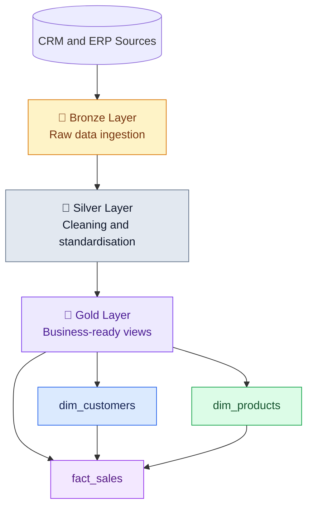
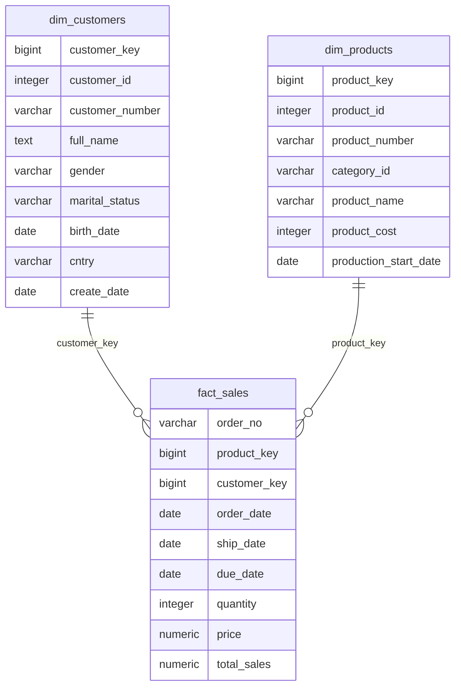

# 🏆 Gold Layer | Data Warehouse

**Turning cleaned CRM and ERP data into a business-friendly sales model**

*PostgreSQL · SQL Views · Data Integration · Dimensional Modelling*

---

## 📌 Project Overview

The **Gold Layer** is the final modelling stage of this data warehouse project. It brings related information together, replaces source-system codes with clearer column names, and prepares the data for reporting and analysis.

| Object | Type | Purpose |
|:--|:--|:--|
| `gold_layer.dim_customers` | Dimension view | Combines customer, ERP customer-detail and location information |
| `gold_layer.dim_products` | Dimension view | Combines product attributes with category information |
| `gold_layer.fact_sales` | Fact view | Connects sales transactions to customer and product dimensions |

> [!NOTE]
> These objects are created with `CREATE VIEW`. They are query definitions, not physically materialised tables.

## 🧭 Where Gold Fits in the Warehouse

| Layer | Role in this project |
|:--|:--|
| 🥉 **Bronze** | Loads source data and supports load checks through procedures and row-count summaries. |
| 🥈 **Silver** | Cleans and standardises data, handles issues such as duplicates and NULL values, and makes source data more consistent. |
| 🥇 **Gold** | Brings related data together and presents it through dimensions and a sales fact view. |

## ⭐ Gold Layer Data Model

The model uses a **star-schema style design**. Customer and product descriptions are stored in separate dimension views, while sales transactions sit in the centre.

The diagram shows the **intended analytical relationships**. The SQL script creates the links by joining the views; it does not add physical foreign-key constraints.

| Fact view column | Dimension | Join condition in SQL | Why it is useful |
|:--|:--|:--|:--|
| `customer_key` | `dim_customers` | `sls_cust_id = customer_id` | Lets sales be analysed by customer attributes |
| `product_key` | `dim_products` | `sls_prd_key = product_number` | Lets sales be analysed by product attributes |

The `LEFT JOIN`s preserve sales rows from the source query when no matching dimension row is found. In those cases, the selected dimension key can be `NULL`.

> [!IMPORTANT]
> `customer_key` and `product_key` are generated with `ROW_NUMBER() OVER()` inside views. These row numbers are not guaranteed to stay attached to the same customer or product after changes to source data or query ordering. For a model refreshed regularly, use stable surrogate keys and a deterministic key-management approach.

---

## 👥 1. `dim_customers` — Customer Dimension

**Sources:** `silver_layer.crm_cust_info`, `silver_layer.erp_cust_details`, `silver_layer.erp_location`

This view combines customer identity and profile details with ERP birth-date and location information.

### Transformation logic

| Column | Data type* | Description |
|:--|:--|:--|
| `customer_key` | `BIGINT` | Generated surrogate key that later to be used in 'sales fact' view |
| `customer_id` | `INTEGER` | Original customer ID from CRM |
| `customer_number` | `VARCHAR(50)` | Customer reference from `cst_key` |
| `full_name` | `TEXT` | First and last name combined |
| `gender` | `VARCHAR(50)` | If CRM gender (`cst_gndr`) is `'Unknown'`, uses ERP gender (`gen`); otherwise, keeps the CRM value. |
| `marital_status` | `VARCHAR(50)` | Customer marital status from CRM |
| `birth_date` | `DATE` | Customer birth date from ERP customer details |
| `cntry` | `VARCHAR(50)` | Uses `LEFT JOIN` to bring in ERP details and location. |
| `create_date` | `DATE` | Date the CRM customer record was created |

---

## 🚲 2. `dim_products` — Product Dimension

**Sources:** `silver_layer.crm_prd_info`, `silver_layer.erp_prd_cat`

This view combines product details with category, subcategory and maintenance information.

### Column dictionary

| Column | Data type* | Description |
|:--|:--|:--|
| `product_key` | `BIGINT` | Generated surrogate key usring row_number(),later to be used as foreign key in fact_sales |
| `product_id` | `INTEGER` | Original product ID from CRM |
| `product_number` | `VARCHAR(50)` | Product code used to match sales records |
| `category_id` | `VARCHAR(50)` | Category identifier from the product record |
| `prd_line` | `VARCHAR(50)` | Product line; source column name is retained |
| `product_categories` | `VARCHAR(50)` | Main product category |
| `product_subcategories` | `VARCHAR(50)` | Product subcategory |
| `product_name` | `VARCHAR(50)` | Product name |
| `product_cost` | `INTEGER` | Product cost from CRM |
| `production_start_date` | `DATE` | Product production start date |
| `maintenance` | `VARCHAR(50)` | Maintenance attribute from category data |

> [!NOTE]
> Applies `WHERE prd_end_dt IS NULL` to include only products whose production end date is not populated. This depends on how the source system uses the end-date field.
> Renames selected fields to make them easier to understand in reports.

---

## 🧾 3. `fact_sales` — Sales Fact

**Source:** `silver_layer.crm_sales_details`

The fact view keeps sales transaction fields and uses the dimension views to attach customer and product keys.

### Transformation logic

| Column | Data type* | Description |
|:--|:--|:--|
| `order_no` | `VARCHAR(50)` | Sales order reference from `sls_ord_num` |
| `product_key` | `BIGINT` | Matches the (`sls_prd_key`) to `dim_products.product_number`. |
| `customer_key` | `BIGINT` | Matches the sales customer ID (`sls_cust_id`) to `dim_customers.customer_id`. |
| `order_date` | `DATE` | Order date |
| `ship_date` | `DATE` | Shipping date |
| `due_date` | `DATE` | Due date recorded for the order |
| `quantity` | `INTEGER` | Quantity recorded on the sales row |
| `price` | `NUMERIC` | Price value from `sls_price` |
| `total_sales` | `NUMERIC` | Sales amount from `sls_sales` |

### Fact grain

> Each output row comes from a row in `silver_layer.crm_sales_details` after the dimension joins. Confirm the source grain before assuming that each row represents a complete order; an order can contain multiple sales lines.
> Gives the order number, dates, quantity, price and sales amount clearer aliases.

---

## 🛠️ SQL Features Used

| SQL feature | How it is used |
|:--|:--|
| `CREATE VIEW` | Defines reusable views for customers, products and sales |
| `LEFT JOIN` | Combines CRM and ERP information while retaining source-side rows |
| `CASE WHEN` | Applies the gender fallback business rule |
| `ROW_NUMBER()` | Generates the current customer and product surrogate keys |
| `WHERE` | Filters products whose production end date is `NULL` |
| Column aliases (`AS`) | Replaces less readable source column names with clearer names |

---

## 🎯 Final Takeaway

The Gold Layer brings customer, product and sales information into a consistent model that is easier to query and use in reporting. The dimension views provide descriptive context, and `fact_sales` connects transactions to those dimensions. The main improvement to consider before relying on the model across repeated refreshes is stable surrogate-key management.

---

**Built with PostgreSQL · SQL · Data Warehousing**

