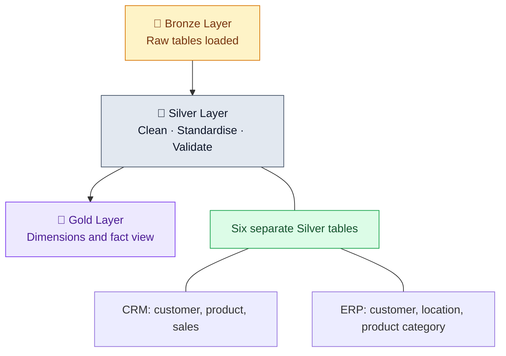
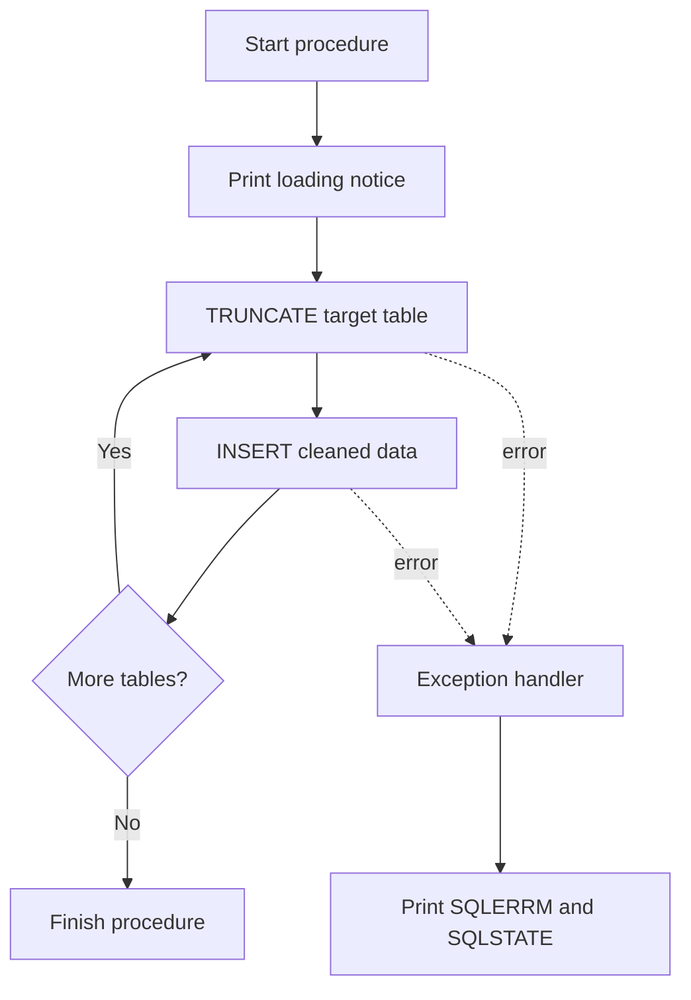

# 🥈 Silver Layer | Data Quality & Transformation

**From raw ingested data to clean, consistent and reliable source tables**

`PostgreSQL` · `PL/pgSQL` · `Data Cleansing` · `Validation` · `Automation`

---

## 📌 Project Overview

The Silver Layer is where raw, messy, uncleaned data is loaded from bronze_layer, where it get cleaned, standardised and prepared for the next stage of the warehouse. Its main focus is **data quality and consistency**, not data modelling. The six source tables remain separate while transformation rules make their values more reliable and easier to use.

| Focus area | Work performed |
|:--|:--|
| Cleansing | Trims spaces, handles missing, unwanted spaces values and removes duplicate customer IDs |
| Standardisation | Converts coded values into readable labels and standardises selected country names |
| Validation | Handles misrepresented date values and out of range birth dates |
| Data correction | Corrects price values(lke -ve, 0, null) and recalculates sales using price × quantity |
| Data preparation | Extracts product category IDs and derives product end dates |
| Automation | Refreshes all six tables through one stored procedure with progress notices and error details |

> [!NOTE]
> Bronze handles ingestion. Silver improves the quality and consistency of the ingested data. Gold later uses the cleaned data for business-friendly dimensions and a fact view.

## 🧭 Pipeline Position

## 🗂️ Tables Processed

| Silver table | Bronze source | Main transformation focus |
|:--|:--|:--|
| `crm_cust_info` | `bronze_layer.crm_cust_info` | Duplicate customer IDs, names, gender and marital status |
| `crm_prd_info` | `bronze_layer.crm_prd_info` | Product key parsing, cost, product line and product date ranges |
| `crm_sales_details` | `bronze_layer.crm_sales_details` | Date conversion, price correction and sales recalculation |
| `erp_cust_details` | `bronze_layer.erp_cust_details` | Customer ID cleanup, birth-date validation and gender standardisation |
| `erp_location` | `bronze_layer.erp_location` | Customer ID cleanup and country standardisation |
| `erp_prd_cat` | `bronze_layer.erp_prd_cat` | Trimming and title casing |

---

## 🧼 Transformation Details & Column Dictionary

The data types below come from the `CREATE TABLE` definitions in the beginnig of silver_layer.sql querry. Every table also has a `created_at DATE DEFAULT CURRENT_DATE`. The procedure omits this column from its inserts, so PostgreSQL fills it with the date of the load.

## 1. `crm_cust_info` — CRM Customer Information

**Source:** `bronze_layer.crm_cust_info`

| Column | Data type | Transformation / description |
|:--|:--|:--|
| `cst_id` | `INT` | Retained from Bronze. NULL IDs are excluded; duplicate IDs are ranked and only the row with the latest `cst_create_date` is retained. |
| `cst_key` | `VARCHAR(50)` | Customer business key retained for matching with ERP customer and location data. |
| `cst_firstname` | `VARCHAR(50)` | Leading and trailing spaces removed using `TRIM()`. |
| `cst_lastname` | `VARCHAR(50)` | Leading and trailing spaces removed using `TRIM()`. |
| `cst_marital_status` | `VARCHAR(50)` | `M` → `Married`, `S` → `Single`; other or unrecognised values become `Unknown`. |
| `cst_gndr` | `VARCHAR(50)` | `M` → `Male`, `F` → `Female`; other or unrecognised values become `Unknown`. |
| `cst_create_date` | `DATE` | Source record creation date; also used to select the latest row for a repeated customer ID. |
| `created_at` | `DATE` | Automatically populated with `CURRENT_DATE` during insertion into Silver. |

**Key rule:** `ROW_NUMBER() OVER (PARTITION BY cst_id ORDER BY cst_create_date DESC)` ranks records per customer. Only `flag_latest_date = 1` is inserted, and rows with NULL `cst_id` are excluded.

---

## 2. `crm_prd_info` — CRM Product Information

**Source:** `bronze_layer.crm_prd_info`

| Column | Data type | Transformation / description |
|:--|:--|:--|
| `prd_id` | `INT` | Product ID retained from Bronze. |
| `prd_cat_id` | `VARCHAR(50)` | Extracted from `prd_key` with a regular expression; hyphens in the extracted category code are replaced with underscores. |
| `prd_key` | `VARCHAR(50)` | Rebuilt from `SUBSTRING(prd_key FROM 7)`, removing the initial 7 digit category portion for product matching. |
| `prd_nm` | `VARCHAR(50)` | Product name retained from Bronze. |
| `prd_cost` | `INT` | NULL cost values are replaced with `0` using `COALESCE()`. |
| `prd_line` | `VARCHAR(50)` | `M` → `Mountains`, `R` → `Road`, `S` → `Other Sales`, `T` → `Touring`; other values become `Unknown`. |
| `prd_start_dt` | `DATE` | Product start date retained from Bronze. |
| `prd_end_dt` | `DATE` | Derived from the next `prd_start_dt` for the same product name using `LEAD()`, minus one day as source end_date has error(date before prd_start_date which is impossible). In the last of leading date column of each partition having no next start date, its end date gets NULL. |
| `created_at` | `DATE` | Automatically populated with `CURRENT_DATE` during insertion into Silver. |

---

## 3. `crm_sales_details` — CRM Sales Transactions

**Source:** `bronze_layer.crm_sales_details`

| Column | Data type | Transformation / description |
|:--|:--|:--|
| `sls_ord_num` | `VARCHAR(50)` | Sales order reference retained from Bronze. |
| `sls_prd_key` | `VARCHAR(50)` | Product reference retained for matching in later stages. |
| `sls_cust_id` | `INT` | Customer ID retained from Bronze. |
| `sls_order_dt` | `DATE` | Eight-character `YYYYMMDD` value is reformatted and cast to `DATE`; other string lengths become NULL. |
| `sls_ship_dt` | `DATE` | Same technique as used in sls_order_dt column. |
| `sls_due_dt` | `DATE` | Same technique as used in sls_order_dt column. |
| `sls_quantity` | `INT` | Quantity retained from Bronze as everything is fine here |
| `sls_price` | `NUMERIC` | If price is NULL or zero, derives it as `sls_sales / sls_quantity`. If negative, `ABS()` makes it positive; otherwise, keeps the original price. |
| `sls_sales` | `NUMERIC` | Recalculated as the cleaned price multiplied by quantity. |
| `created_at` | `DATE` | Automatically populated with `CURRENT_DATE` during insertion into Silver. |

**Sales calculation:** the SQL sets `sls_sales` to the cleaned `sls_price * sls_quantity`.

---

## 4. `erp_cust_details` — ERP Customer Details

**Source:** `bronze_layer.erp_cust_details`

| Column | Data type | Transformation / description |
|:--|:--|:--|
| `cid` | `VARCHAR(50)` | If the ID starts with `NAS` (case-insensitive), removes the first three characters; otherwise retains the ID. |
| `bdate` | `DATE` | Future birth dates, including today's date, become NULL using `bdate >= CURRENT_DATE`. |
| `gen` | `VARCHAR(50)` | `M` → `Male`, `F` → `Female`; blank and NULL values become `Unknown`. Other values are retained as-is. |
| `created_at` | `DATE` | Automatically populated with `CURRENT_DATE` during insertion into Silver. |

The cleaned customer ID helps align ERP identifiers with CRM customer keys.

---

## 5. `erp_location` — ERP Customer Location

**Source:** `bronze_layer.erp_location`

| Column | Data type | Transformation / description |
|:--|:--|:--|
| `cid` | `VARCHAR(50)` | Hyphens are removed from the ID using `REPLACE()`. |
| `cntry` | `VARCHAR(50)` | `USA` and `US` become `United States`; `DE` becomes `Germany`; blank and NULL values become `Unknown`. Other values are retained as supplied. |
| `created_at` | `DATE` | Automatically populated with `CURRENT_DATE` during insertion into Silver. |

The query standardises selected country codes. It does not trim or standardise every remaining country value, so additional variants may need review if they exist in the source.

---

## 6. `erp_prd_cat` — ERP Product Categories

**Source:** `bronze_layer.erp_prd_cat`

The SQL summary says this source table is already clean. The procedure still trims text fields and applies title casing to category descriptions.

| Column | Data type | Transformation / description |
|:--|:--|:--|
| `id` | `VARCHAR(50)` | Trimmed using `TRIM()`. Defined as the primary key in the Silver table. |
| `cat` | `VARCHAR(50)` | Trimmed and converted to title case using `INITCAP()`. |
| `subcat` | `VARCHAR(50)` | Trimmed and converted to title case using `INITCAP()`. |
| `maintenance` | `VARCHAR(50)` | Trimmed and converted to title case using `INITCAP()`. |
| `created_at` | `DATE` | Automatically populated with `CURRENT_DATE` during insertion into Silver. |

---

## ⚙️ Refresh Automation — `load_silver_layer_tables()`

The procedure `silver_layer.load_silver_layer_tables()` automates the refresh of all six Silver tables.

### Procedure behaviour

- **Refresh pattern:** Each target table is truncated and then repopulated from its Bronze source.
- **Progress messages:** `RAISE NOTICE` announces the load and individual table steps.
- **Error reporting:** The `WHEN OTHERS` handler prints `SQLERRM` (error message) and `SQLSTATE` (error code).
- **Load metadata:** `created_at` defaults to the current date when not specified in the insert.

### SQL features used

| Feature | Purpose in this script |
|:--|:--|
| `TRUNCATE` | Clears the existing target table before refresh |
| `INSERT INTO ... SELECT` | Loads transformed rows from Bronze into Silver |
| `ROW_NUMBER()` | Ranks repeated customer IDs to keep the latest record |
| `SUBSTRING()` and regex | use to clean/extract digit/alphabet/symbols of data --> deep clean |
| `COALESCE()` | Replaces NULL product costs with zero |
| `CASE WHEN` | Applies rules to coded values, dates and prices |
| `TRIM()`, `REPLACE()`, `UPPER()`, `INITCAP()` | Cleans strings and standardises labels |
| `ABS()` | Converts negative price values to positive values |
| `LEAD()` and `INTERVAL` | Derives product end dates from the next start date |
| `ILIKE` | Performs case-insensitive matching of the `NAS` ID prefix |
| `RAISE NOTICE` | Displays progress and error details |

---

---

**Silver Layer: cleaner data, clearer values, and a repeatable refresh process.**

*Built with PostgreSQL · SQL · PL/pgSQL*

